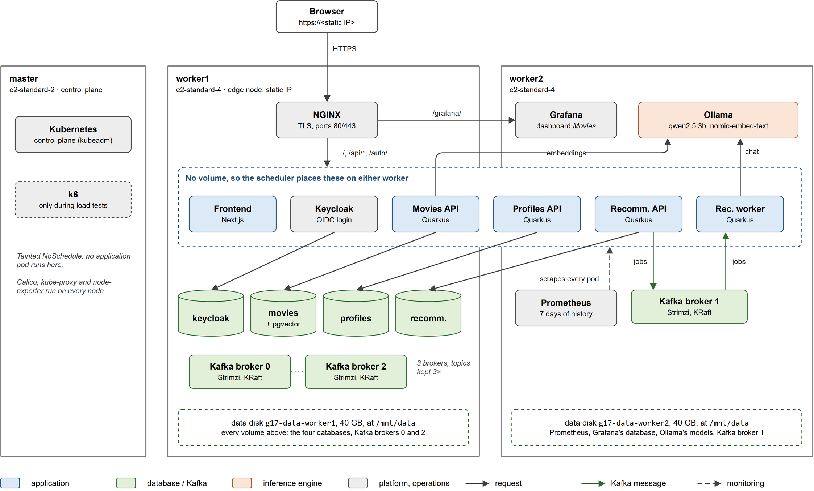
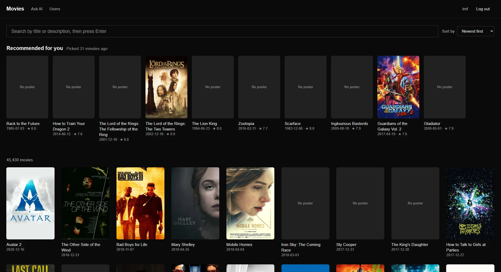
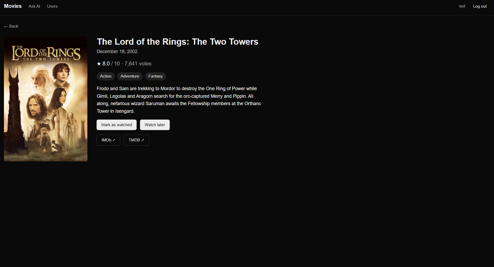
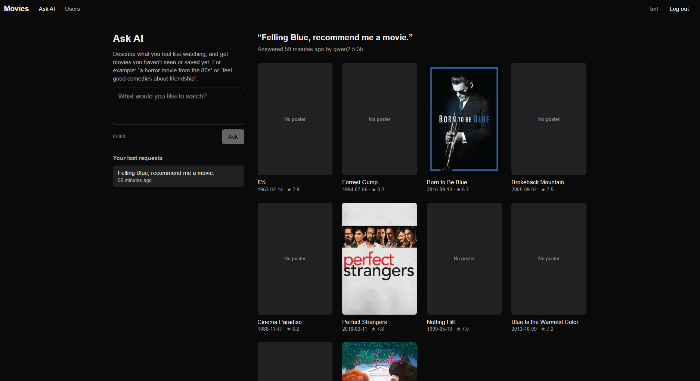
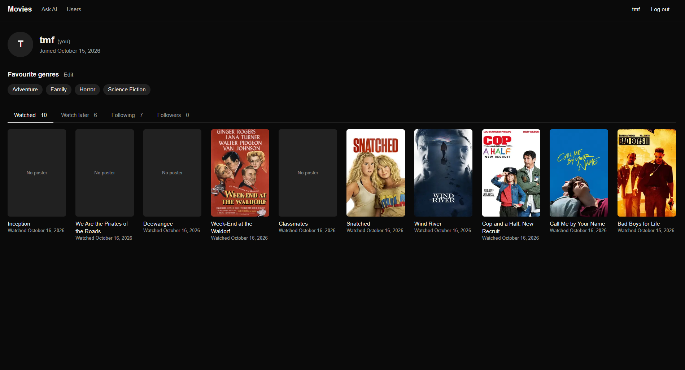
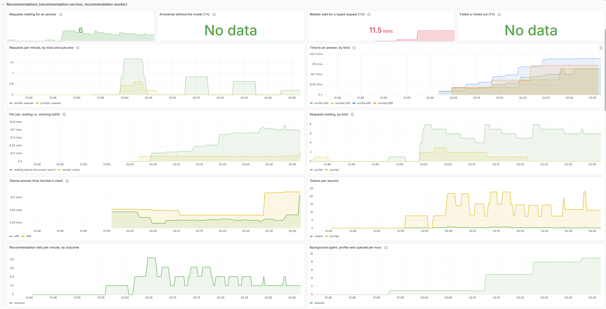
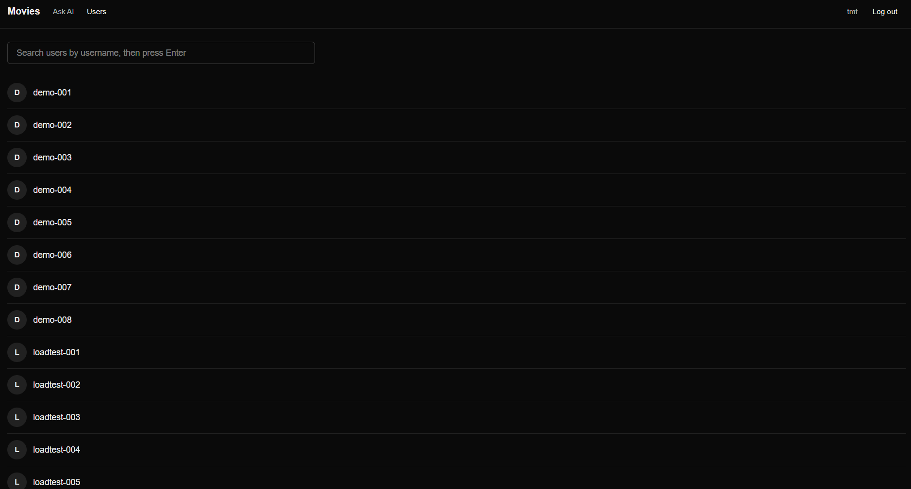

# Movie Recommendation Hub

**PSIA 2026/27, Group 17**: Manuel Fernandes (106410), João Russo (116543), Tiago Fonseca (112346)

A movie catalogue built on [The Movies Dataset](https://www.kaggle.com/datasets/rounakbanik/the-movies-dataset) (about 45,000 TMDB movies). Users register and log in through Keycloak, then browse and search movies, keep a profile of their favourite genres and the movies they've seen, save movies to watch later, and follow other users, whose profiles they can browse. A language model recommends movies to them in two ways:

- *Recommended for you* is ten movies picked from their profile and from what the people they follow watched. A background agent keeps the set up to date, so it's ready when they log in.
- *Ask AI* is ten movies matching a request they type, like "a horror movie from the 80s".

The system is four Java (Quarkus) microservices and a Next.js website, one PostgreSQL database per service, Kafka between the recommendation API and its worker, and Ollama as the inference engine (`qwen2.5:3b` to choose movies, `nomic-embed-text` to search by meaning). It runs on your own machine, entirely in Docker with one command, or in Google Cloud, on a self-hosted Kubernetes cluster that Terraform and Ansible create and that Prometheus and Grafana monitor. Persistent state is the project's advanced feature, so data survives stopping and destroying every VM.



*In Google Cloud, NGINX on worker1 is the only public entry point. Pods with a volume (the databases, Kafka's brokers, Ollama, Prometheus, Grafana) always run on the worker that holds their data disk, while the others can run on either worker.*

## Components

| Component | Technology | Code | Documentation |
|---|---|---|---|
| Website | Next.js 16, React 19, Tailwind CSS 4 | `frontend/` | [frontend/README.md](frontend/README.md) |
| Movies API for the catalogue, search and search by meaning | Java 21+, Quarkus, PostgreSQL 16 + pgvector | `backend/movies-service/` | [backend/README.md](backend/README.md) |
| Profiles API for genres, watched movies, the watchlist and follows | Quarkus, PostgreSQL 16 | `backend/profiles-service/` | [backend/README.md](backend/README.md) |
| Recommendation API and background agent | Quarkus, PostgreSQL 16, Kafka | `backend/recommendation-service/` | [backend/README.md](backend/README.md) |
| Recommendation worker | Quarkus, Kafka, Ollama | `backend/recommendation-worker/` | [backend/README.md](backend/README.md) |
| Accounts and login | Keycloak 26 (OpenID Connect) | `infra/keycloak/` | [backend/README.md → Authentication](backend/README.md#authentication-and-service-accounts) |
| Inference engine | Ollama with `qwen2.5:3b` and `nomic-embed-text` | | [backend/README.md → Choosing a model](backend/README.md#choosing-a-model) |
| Local deployment | Docker Compose, `just` | `justfile`, `*/compose.yaml` | [infra/README.md → Running locally](infra/README.md#running-locally-with-docker-compose) |
| Cloud deployment | Terraform, Ansible, kubeadm, Calico, Strimzi, NGINX | `infra/` | [infra/README.md](infra/README.md) |
| Monitoring | Prometheus, Grafana, Micrometer | `infra/k8s/` | [infra/README.md → Monitoring](infra/README.md#monitoring) |
| Load test | k6 | `infra/loadtest/` | [infra/loadtest/README.md](infra/loadtest/README.md) |
| Report | LaTeX | `report/` | [report/README.md](report/README.md) |

Each service has its own database, and no service reads another's. When a service needs another's data, it calls that service's API with a token.

## Screenshots

| | |
|---|---|
|  |  |
| *`/movies` with Recommended for you, search and the catalogue* | *A movie, with mark as watched and watch later* |
|  |  |
| *Ask AI with a request and its answer* | *A profile with genres, watched movies and follows* |
|  |  |
| *The recommendations row of Grafana's Movies dashboard* | *Users* |

## Quick start

On your own machine, entirely in Docker. You need [Docker](https://docs.docker.com/engine/install/) (with Compose v2) and [just](https://github.com/casey/just#installation). The stack needs about 10 GB of memory, so on Windows give WSL 2 at least that much. From the project root:

```bash
just local-first-up    # the first time: infrastructure, the movies data, backend, frontend
just local-up          # every later time (the movies data is already in its volume)
just local-down        # stop and remove the containers; the data is kept
```

Then open `http://localhost:3000` and register. The first run takes several minutes, because it downloads the images and the models (about 2.2 GB) and builds five images. *Recommended for you* and *Ask AI* take a few minutes each on a CPU, and a notification says when they're ready.

These start three Docker Compose projects in order (`infra/`, `backend/`, `frontend/`). What each one contains, its default settings and how to reset the data are explained in [infra/README.md → Running locally](infra/README.md#running-locally-with-docker-compose). To work on the code with live reload instead, see [backend/README.md → Running the services by hand](backend/README.md#running-the-services-by-hand) and [frontend/README.md](frontend/README.md).

Useful commands, from the project root:

```bash
docker ps                                                             # all containers, with their health
docker compose -f backend/compose.yaml logs -f movies-service         # a service's log
docker compose -f backend/compose.yaml up -d --build movies-service   # rebuild one service after changing its code
```

## Deploy it to Google Cloud

The same system runs on a Kubernetes cluster of three VMs, which are one control plane and two workers (kubeadm, containerd, Calico), with NGINX as the only public entry point (HTTPS), Kafka with three brokers, one PostgreSQL per service, Ollama, Keycloak, Prometheus and Grafana. Your computer needs only Docker, *just* and the Google Cloud CLI, because Terraform, Ansible and kubectl run in the management container. [infra/README.md](infra/README.md) explains every step and how to fix what can go wrong.

You need a Google Cloud project with billing and the Compute Engine API, a service account key for Terraform, and a Docker Hub account. [infra/README.md → One-time setup](infra/README.md#one-time-setup) has the exact commands. Run the last steps inside the `infra/` subdirectory:

```bash
gcloud iam service-accounts keys create terraform/credentials.json --iam-account=terraform@<project>.iam.gserviceaccount.com
echo 'gcp_project_id = "<project>"' > terraform/terraform.tfvars
just keygen                                   # the SSH key Terraform installs on the VMs
docker login -u <user>                        # to push the images
```

Then deploy:

```bash
just images docker.io/<user> v1               # build the 5 images and push them (again after code changes)
just mgmt-start                               # the management container (Terraform, Ansible, kubectl)
just mgmt                                     # a shell in it; then:
just all                                      # VMs + Kubernetes + platform + application, about 25 minutes
```

Set `image_registry` and `image_tag` in `infra/ansible/group_vars/all.yml` to what you pushed. At the end, `just all` prints the application's address (`https://<static IP>`), Grafana's (`/grafana`) and Keycloak's admin console (`/auth/admin`). Their passwords are stored in `infra/ansible/.secrets/`.

The VMs cost about 0.40 USD an hour while they exist, so stop or destroy them when you're done:

```bash
just stop          # stop the three VMs; nothing is lost
just start         # start them again, and wait until the application answers
just destroy       # delete the VMs and the network; the data disks and the static IP are kept
just destroy-data  # delete those too: every account and recommendation is lost
```

After `just destroy`, the next `just all` reattaches the data disks, and the application comes back with every account, profile, recommendation and Kafka message ([infra/README.md → Persistent data](infra/README.md#persistent-data)). Every command is listed in [infra/README.md → Command reference](infra/README.md#command-reference).

## Repository layout

| Path | Contents |
|---|---|
| `frontend/` | The Next.js website, its Dockerfile and Compose file |
| `backend/` | The four Quarkus services, one folder each. `backend/Dockerfile` builds any of them, and `backend/compose.yaml` runs them locally |
| `infra/compose.yaml`, `infra/keycloak/`, `infra/init/` | The local infrastructure (databases, Kafka, Ollama, Keycloak), and the Keycloak realm both setups import |
| `infra/terraform/` | The Google Cloud network, firewall and VMs. `persistent/` holds the data disks and the static IP, in a stack of their own |
| `infra/ansible/` | The playbooks that install Kubernetes and deploy everything onto it, and their settings (`group_vars/all.yml`) |
| `infra/k8s/` | The Kubernetes manifests (templates Ansible fills in) and Grafana's dashboard |
| `infra/mgmt/`, `infra/justfile`, `infra/build-images.sh` | The management container, the cloud deployment's commands, the image build |
| `infra/evidence/`, `infra/loadtest/` | The persistence tests, and the load test of the report's evaluation |
| `data/` | The cleaned catalogue as a `pg_dump` (`movies_dump.sql`), the raw CSVs and how they were cleaned (`schema.sql`) |
| `docs/` | The diagrams (editable `.drawio` sources, with PNG exports for the READMEs and PDF exports for the report) and the screenshots |
| `report/` | The project report (LaTeX) and its PDF, `project-g17.pdf` |
| `justfile` | The local commands `just local-first-up`, `just local-up` and `just local-down` |
