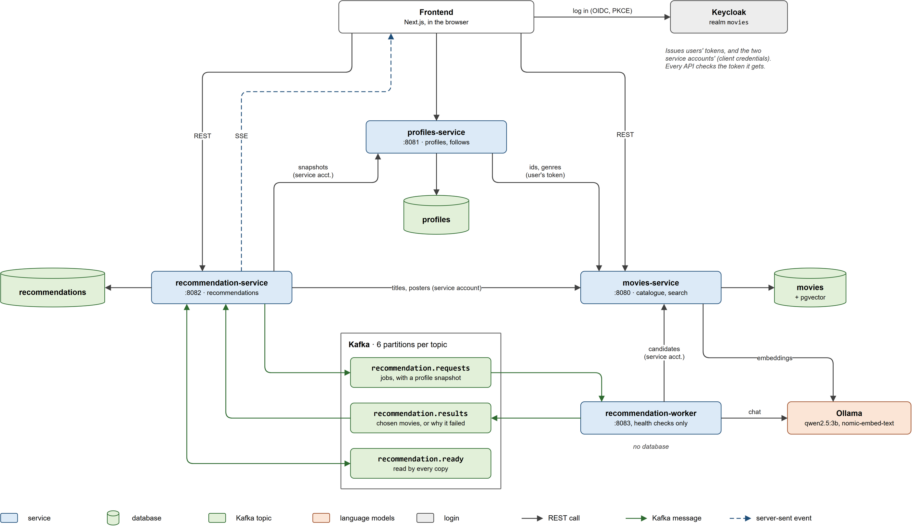
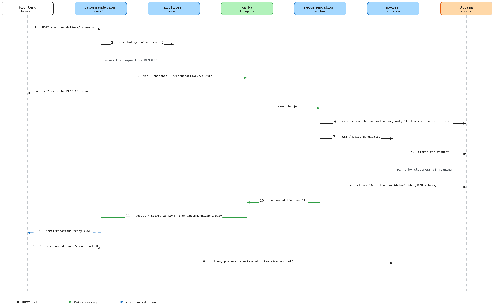

# Backend

The backend is four [Quarkus](https://quarkus.io/) services in Java 21+. Three of them are REST APIs that the frontend calls from the browser. The fourth, the recommendation worker, has no API and only takes jobs from Kafka.

| Service | Path | Port (dev) | Owns | Does |
|---|---|---|---|---|
| movies-service | `movies-service/` | 8080 | the movies database (`postgres`, schema `movies`) | The catalogue, with listing, search by words and by meaning, and candidate movies for recommendations |
| profiles-service | `profiles-service/` | 8081 | the profiles database (`profiles-db`, schema `profiles`) | Favourite genres, watched movies, the watch-later list, follows |
| recommendation-service | `recommendation-service/` | 8082 | the recommendations database (`recommendations-db`, schema `recommendations`) | "Recommended for you" and "Ask AI", for which it queues jobs, stores results and tells the browser over SSE |
| recommendation-worker | `recommendation-worker/` | 8083, health checks only | nothing | Takes jobs from Kafka, picks candidates through movies-service, lets the language model choose ten |

They run on the infrastructure from [`../infra/compose.yaml`](../infra/compose.yaml) (the three databases, Kafka, Ollama and Keycloak). [`../infra/README.md`](../infra/README.md) explains how to start it, and how the same services are deployed on Kubernetes.

## Contents

- [How the services fit together](#how-the-services-fit-together)
- [Feature flows](#feature-flows), covering [search](#search), [search by meaning](#search-by-meaning), [profile changes](#profile-changes), [Recommended for you](#recommended-for-you), [Ask AI](#ask-ai), [what's kept](#whats-kept-and-the-sweeper)
- [Authentication and service accounts](#authentication-and-service-accounts)
- [Kafka topics](#kafka-topics)
- [Choosing a model](#choosing-a-model)
- [Application metrics](#application-metrics)
- [Production build and environment variables](#production-build-and-environment-variables)
- [Configuration](#configuration)

## How the services fit together



- Each service has its own database instance, and no service reads another's. When a service needs another's data, it asks that service's API. Movies and genres are stored elsewhere only as ids, with no foreign keys.
- The services call each other over REST, with a token on every call. The browser sends the user's Keycloak access token to each API. profiles-service passes the same user token on to movies-service. Calls made for nobody in particular (the background agent reading every profile, the worker looking up movies) use a service account's own token instead (see [Service accounts](#service-accounts)).
- The two recommendation services talk through Kafka. Choosing movies takes the model minutes, so recommendation-service answers at once (`202`), puts a job on `recommendation.requests`, and the worker sends the result back on `recommendation.results`. The job carries a snapshot of the profile, so the worker never calls profiles-service and no user token travels through Kafka.
- The browser hears about results over SSE. Once a result is stored, recommendation-service announces it on `recommendation.ready`. Every copy of the service reads that topic and sends a `recommendations-ready` event to the user's open connections, wherever they are.
- Ollama runs both models. The worker uses the chat model (`qwen2.5:3b`) to choose, and movies-service uses the embedding model (`nomic-embed-text`) for search by meaning.

| Caller | Calls | With |
|---|---|---|
| Browser | movies-service, profiles-service, recommendation-service (REST and SSE) | The user's token |
| profiles-service | movies-service (`GET /genres`, `GET /movies/batch`) | The user's token, passed on |
| recommendation-service | profiles-service (`GET /internal/profiles`, `GET /internal/profiles/{id}/snapshot`) | Its service account (role `profiles-reader`) |
| recommendation-service | movies-service (`GET /movies/batch`) | Its service account |
| recommendation-worker | movies-service (`GET /genres`, `GET /movies/batch`, `POST /movies/candidates`) | Its service account |
| movies-service | Ollama (`POST /api/embed`) | None |
| recommendation-worker | Ollama (`POST /api/chat`, `GET /api/tags` for the health check) | None |

Every service exposes `/q/health` and Prometheus metrics at `/q/metrics`. The three APIs also serve their OpenAPI document at `/q/openapi` and Swagger UI at `/q/swagger-ui`. Those, and `/q/health`, need no token.

## Feature flows

### Search

`GET /movies/search` (`MovieSearch.java`) looks for the words of `q` in movie titles and descriptions, using PostgreSQL's built-in full-text search on the columns from migrations V2, V3 and V5.

- Words match in any form, so `dreams` also finds "dream", and `running` finds "run" (English word roots).
- Search-engine syntax works, with `"dark knight"` for an exact phrase, `alien or predator` for either word, `heist -casino` to exclude a word (`websearch_to_tsquery`).
- The start of a title word is enough, so `Ava` finds *Avatar*, `incep` finds *Inception*, and `star wa` finds the *Star Wars* films.
- Accents don't matter, so `amelie` finds *Amélie*, and `pokemon` finds the *Pokémon* films (`unaccent`).
- Common words ("the", "of", "it") are ignored. A query made only of such words, like `It` or `The Who`, instead matches title words exactly as written (`title_vector`).
- Typos in titles are tolerated. When there are fewer than 10 matches, titles that look similar are added below them (trigram similarity), so `godfater` finds *The Godfather* and `incepton` finds *Inception*.

By best match, results come in four tiers:

1. Titles containing the words, most popular (most rated) first. A title that is exactly the query counts as ten times as popular, so `batman` puts *Batman* (1989) first.
2. Titles with words starting with the query, most popular first.
3. Movies that match only in their description, most relevant first (`ts_rank_cd`).
4. Similar-looking titles, most similar first.

Prefix and similar-title matching are skipped for queries that use search syntax (quotes, `or`, or `-word`), so an excluded word stays excluded. Descriptions are matched as English. With `sort` set to a field, the same matches come in that field's order instead.

### Search by meaning

Word search only finds movies that use the request's words, so "astronauts stranded far from home" finds *Home Alone* before *The Martian*. So for Ask AI, movies-service also searches by meaning (`MovieEmbeddings.java`):

1. Every candidate movie gets an embedding, a list of 768 numbers that the embedding model (`nomic-embed-text`, in Ollama) computes from its title, year, genres and description, e.g. "Alien (1979). Horror, Science Fiction. During its return to the earth, ...". Movies about similar things get nearby vectors, whatever words they use. They're kept in `movies.movie_embedding`, in a pgvector column, with the model that made them.
2. A background job fills that table. It takes the movies with at least 50 votes (the ones that can be candidates, about 9,100), most voted first, in batches of 4, for up to 50 seconds a minute until all are done, and again for every movie if the model changes. It's resumable, and `MOVIES_EMBEDDINGS_BACKFILL=false` pauses it. The log says how many are left (`Embedded 16 movies with nomic-embed-text; 9078 to go`).
3. A request's `meaning` is embedded the same way. The last 200 requests' vectors are remembered, since the worker asks for candidates several times per request.
4. Candidates are ranked by how close they are to it (cosine distance, `<=>`), then by quality. The request's keywords stop filtering and only add a small bonus, for exact titles and names. Genres, years and everything else still filter.
5. If Ollama can't be reached, the meaning is ignored and the keywords filter as before.

How long the first run takes depends on the CPU. It takes minutes on a machine with AVX2, but on a virtual CPU without it (`grep -c avx2 /proc/cpuinfo` prints 0) about 3 seconds a movie, some 8 hours in all, during which the chat model is slower too. Movies not embedded yet rank below those that are. On a VM, giving it the host's CPU type (in Proxmox, **Hardware → Processor → Type: host**) fixes both.

### Profile changes

Registering in Keycloak doesn't create a profile, because profiles-service creates it on the user's first request. On every request to profiles-service's user endpoints, `CurrentUser.java` upserts the profile from the token. The Keycloak user id (`sub`) becomes the profile id, and `preferred_username` the username, refreshed if it changed in Keycloak. The frontend makes such a request right after login, so users show up under **Users** as soon as they first log in to the app. Accounts created in the Keycloak admin console stay out of the list until their owner logs in once.

A change such as `PUT /profiles/me/watched/238` goes through these steps:

1. The service finds (or creates) the caller's profile from the token.
2. It asks movies-service whether movie 238 exists (`GET /movies/batch`, with the user's token). An unknown one returns `404`, and movies-service being down returns `503`.
3. It inserts the row, doing nothing if it's already there, and removes the movie from the watchlist.
4. It sets the profile's `last_changed_at` to now, and counts the action in `profiles_actions_total`.

Every change to favourite genres, watched movies, the watchlist or follows sets `last_changed_at`. A removal that removed nothing changes nothing.

**Fingerprints** let recommendation-service tell whether anything changed without storing profiles. `ProfileSnapshots.java` builds each snapshot and hashes it with SHA-256:

- `own` covers the favourite genres (as a set), and the watched movies and watchlist (in recency order).
- `social` covers what the 20 most recently followed profiles watched, as a set of (movie, how many watched it).
- `root` combines both, so equal roots mean identical recommendation inputs.

The username isn't part of it, since it doesn't change the recommendations.

### Recommended for you

Making a set takes the model minutes, so the service only makes one when its inputs changed. Each request records the fingerprint of the profile it was made from, and the **recipe**, which is the model and the pipeline's version (`RecommendationPipeline.VERSION`, bumped when the prompts or the candidate rules change), so results are only reused when they were made the same way.

1. The first set starts when the user opens `/movies`, whose page calls `GET /recommendations/me` (status `PREPARING`). Asking again while it's being made returns the same request. If the user hasn't asked by then, the background agent's next run starts it, since a profile with no set always needs one.
2. To queue a set, recommendation-service reads the profile's snapshot from profiles-service (`/internal/profiles/{id}/snapshot`, with its service account). A user who has no profile yet gets an empty one.
3. Identical inputs share results. If a finished set made by the current recipe from the same `root` fingerprint exists, for any user, it's copied at once instead of asking the model, so two new users with empty profiles, for example, get the same set. Otherwise a `PENDING` request is saved and the job published to Kafka. If Kafka doesn't accept it within 10 seconds, the request is removed and the failure counted.
4. The worker chooses ten movies (as for [Ask AI](#ask-ai), but with the user's taste instead of a request, meaning their favourite genres plus the three genres most common in what they recently watched and saved). The result is stored, the old set deleted, and `profile_state` updated, and the browser hears about it over SSE.

**The background agent** (`BackgroundAgent.java`) keeps the set up to date. 30 seconds after startup and then every 10 minutes, it pages through `/internal/profiles` and, for each profile, compares its fingerprint with the one in `profile_state`. It queues a new set when:

- the user has none yet,
- their own genres, watched movies or watchlist changed (`own`), but only once `last_changed_at` is more than 2 minutes old, so marking five movies in a row makes a single set,
- or what the people they follow watched changed (`social`), at the next run.

It skips a profile while a set is being made, and after a failure until the back-off has passed. An unchanged profile keeps its set, however old, and so does a change of model. It queues at most 20 per run, so a burst of changes doesn't bury users' Ask AI requests, and the rest wait for the next run. With more than one copy of the service, a PostgreSQL advisory lock makes only one of them run it.

After a failure, the failed request is deleted, the old set stays, and `profile_state` counts the attempt. The agent retries after 30 minutes, then waits twice as long after each further failure, up to 6 hours.

### Ask AI



1. The browser sends `POST /recommendations/requests` with `{ "prompt": "..." }`.
2. recommendation-service checks that the user has no other Ask AI request pending (`409` if so), and reads their snapshot from profiles-service.
3. The same question is answered at once if the user asked it before with an unchanged profile. The prompt (ignoring case and extra spaces) is hashed with the profile's `root` fingerprint, and a finished request with the same hash and the current recipe is moved to the top of the history and returned with `200`.
4. Otherwise it saves a `PENDING` request and publishes the job, with the snapshot, to `recommendation.requests`, keyed by user id, then answers `202`.
5. The worker takes the job (one at a time per worker, see [Kafka topics](#kafka-topics)) and narrows 45,000 movies down to a few dozen candidates (`RecommendationPipeline.java`):
   - The request becomes search filters, taken only from what it states. These are the genres it names ("scary" counts as horror, "sci-fi" as science fiction), a range of years only if it mentions a year or decade (only then the model is asked, under a JSON schema, to turn "from the 80s" into 1980 to 1989), and its other words as keywords, up to 8 words of 3 letters or more. Filler words ("movies", "about", "like", "from"…) never count. So "movies about serial killers from the 2000s" searches for *serial* or *killers*, released 2000 to 2009, and "lord of the rings" for *lord* or *rings*. The model isn't asked for genres or keywords, because a small model asked for a field fills it in with years, genres or words nobody asked for. A request that states none of these falls back to the user's taste.
   - movies-service picks 30 candidates (`POST /movies/candidates`) that match the filters, leaving out what the user has watched or saved and movies with fewer than 50 votes. With the request as `meaning`, they're the movies closest in meaning to it (see [Search by meaning](#search-by-meaning)), then the best rated. If too few match, the filters are loosened step by step, trying without keywords, then genres only, then years only, then keywords only. A request is never padded with unfiltered picks once something matched.
   - Up to 20 more are movies the people the user follows watched, if they pass the same genre and year filters.
   - Candidates are scored by a vote-weighted rating (a Bayesian average, so a 9.0 from 3 votes doesn't beat an 8.3 from 20,000), plus 30 times the closeness of meaning, a bonus for matching words (at most 0.3 when ranking by meaning, up to 2 otherwise), 0.3 for each genre in common, 0.3 more for each favourite genre, and 0.2 for each followed person who watched it (up to 0.6).
6. The model chooses ten, reading each candidate's title, year, genres, rating and the first 160 characters of its description, plus the user's favourite genres, the ten movies they watched most recently and five from their watchlist. Its answer must follow a JSON schema whose ids can only be the candidates' (Ollama's structured output), so it can't make movies up. Anything else is dropped, and if it chooses fewer than ten, the best-ranked candidates fill the gaps.
7. The worker sends the result (the movie ids, the model, the recipe and how long it took, or why it failed) to `recommendation.results`.
8. recommendation-service stores it (`DONE`, or `FAILED` with the reason), keeps the last five answers, and publishes a `ReadyEvent` to `recommendation.ready`.
9. Every copy of the service reads that event, and the one holding the user's SSE connection sends `recommendations-ready`.
10. The browser fetches `GET /recommendations/requests/{id}`, and recommendation-service adds titles and posters from movies-service (`/movies/batch`).

### What's kept, and the sweeper

- Recommended for you keeps only the current set, plus the one being made. The old set is deleted once the new one is stored. A failed attempt is deleted and counted in `profile_state`, and the old set stays.
- Ask AI keeps the last five answers. A failed request stays out of the history. It's kept for an hour, so a user who comes back is told (`GET /recommendations/requests/current`), and deleted with the next success.
- Results arriving twice, or for a request that was already given up on, change nothing.

**The sweeper** (`PendingSweeper.java`) runs every minute. A request still `PENDING` an hour after it was made fails with "No answer after 1 hour.", and failed Ask AI requests older than an hour are deleted. It's a safety net for a job lost from Kafka, which would otherwise block the user's Ask AI for good. A slow worker just makes requests wait. The hour includes the time spent waiting in the queue, so on a slow machine keep `recommendation.timeout` well above a few jobs' time. Ask AI requests aren't retried, but Recommended for you is, by the agent.

## Authentication and service accounts

User accounts live in [Keycloak](https://www.keycloak.org/), in a realm called `movies`, defined in [`../infra/keycloak/movies-realm.json`](../infra/keycloak/movies-realm.json), which Keycloak imports on its first start.

- Anyone can create an account from the login page's "Register" link, with a username, email, first and last name, and a password of at least 8 characters that isn't the username or email.
- Users log in with their username or email. Repeated wrong passwords temporarily lock the account.
- There's no email verification or password reset yet, because Keycloak has no mail server configured.
- Every logged-in user can do everything the APIs offer, except change someone else's profile or see someone else's watchlist and recommendations. Users have no roles, and the realm's one role, `profiles-reader`, belongs to recommendation-service's own account.

### How the pieces fit

1. An app sends the user to Keycloak's login page. Keycloak handles registration and login, then sends the user back to the app with a code.
2. The app exchanges that code for an **access token**, which is a signed JWT that says who the user is, valid for 5 minutes (Keycloak's default).
3. The app sends the token to the APIs in the `Authorization: Bearer` header. Each API (`quarkus-oidc`, `application-type=service`) checks the signature, the expiry, the issuer (in dev, `http://localhost:8180/realms/movies`) and the audience. They never see passwords.

The realm has two apps (clients) that log users in. Both are public clients using the authorization code flow with PKCE, and both add `movies-service`, `profiles-service` and `recommendation-service` to their tokens' audience. Each API rejects tokens without its own name there (`quarkus.oidc.token.audience`), so a token issued for some other app in the realm doesn't work against them.

| Client | Used by | Redirect URIs |
|---|---|---|
| `movies-frontend` | The Next.js app | `http://localhost:3000/*` |
| `movies-swagger-ui` | The APIs' Swagger UIs | `http://localhost:8080/q/swagger-ui/*`, `http://localhost:8081/q/swagger-ui/*`, `http://localhost:8082/q/swagger-ui/*` |

### Service accounts

Some calls aren't made for a user, since the background agent reads every profile and the worker looks up movies while nobody waits. So both services log in to Keycloak as themselves, with a client id and secret (the OAuth client credentials grant, `quarkus-oidc-client`), and send that token instead. These two clients are confidential and can't log users in.

| Client | Calls | Token audience | Secret in dev |
|---|---|---|---|
| `recommendation-service` | profiles-service's `/internal/...` endpoints (with the `profiles-reader` role), and movies-service | `profiles-service`, `movies-service` | `recommendation-service-dev-secret`, or `RECOMMENDATION_SERVICE_SECRET` |
| `recommendation-worker` | movies-service | `movies-service` | `recommendation-worker-dev-secret`, or `RECOMMENDATION_WORKER_SECRET` |

Set real secrets anywhere but on your own machine, in Keycloak (the client's **Credentials** tab) and in the matching variable. Both services find Keycloak through `KEYCLOAK_REALM_URL` (default `http://localhost:8180/realms/movies`).

### Keycloak admin console

`http://localhost:8180/admin`, user `admin`, password `admin` (or `KEYCLOAK_ADMIN` and `KEYCLOAK_ADMIN_PASSWORD`, set before the first start). Switch to the `movies` realm in the top-left menu to see users, clients and realm settings.

Changes made in the console are stored in Keycloak's database, not in `movies-realm.json`. The realm file is only imported when the realm doesn't exist yet, so later edits to it don't reach an existing Keycloak. To apply them, either make the same change in the console, or delete the `movies` realm in the console (**this deletes its user accounts**) and restart Keycloak with `docker compose -f infra/compose.yaml restart keycloak`.

**If your Keycloak was set up before profiles-service existed**, run this once from the project root. It adds the `profiles-service` audience and the second Swagger UI address, and keeps all accounts:

```bash
./infra/keycloak/add-profiles-service.sh
```

**If it was set up before the recommendation services existed**, run this too, after the one above. It adds the `profiles-reader` role, the two service clients with their dev secrets, the `recommendation-service` audience and the third Swagger UI address, and also keeps all accounts:

```bash
./infra/keycloak/add-recommendations.sh
```

Both are safe to run more than once. Then log out and in again, so your token includes the new audiences.

## Kafka topics

Kafka creates them on first use, with 6 partitions each (`KAFKA_NUM_PARTITIONS` in `infra/compose.yaml`).

| Topic | From → to | Carries |
|---|---|---|
| `recommendation.requests` | recommendation-service → worker | Jobs (`RecommendationJob`), each with the request and a snapshot of the profile. Keyed by user id, so one user's jobs are handled in order. All workers share one consumer group, `recommendation-worker`, so each job goes to one of them, and up to 6 can work in parallel |
| `recommendation.results` | worker → recommendation-service | `RecommendationResult`, carrying the chosen movies, or why it failed, with the model and recipe. Keyed by user id. All copies of the service share the group `recommendation-service`, so each result is stored once |
| `recommendation.ready` | recommendation-service → every copy of it | `ReadyEvent`, saying "a result was stored". Each copy reads all of them, in its own group (a random id per start, from the latest offset), to tell the users connected to it |

A job is only taken off the queue once its result is sent, one at a time per worker (`max.poll.records=1`), so a worker that stops mid-job leaves it for the next one. Since a model can take minutes on one job, the worker's Kafka consumer allows a job up to 30 minutes (`throttled.unprocessed-record-max-age.ms`), instead of the default 60 seconds.

## Choosing a model

The default chat model, `qwen2.5:3b`, needs about 2.5 GB of memory and chooses well, but on a CPU it takes a few minutes per set. Smaller models are faster, but choose less well:

```bash
docker exec ollama ollama pull qwen2.5:0.5b     # or qwen2.5:1.5b
cd backend/recommendation-worker
RECOMMENDATION_MODEL=qwen2.5:0.5b ./mvnw quarkus:dev
```

`RECOMMENDATION_CANDIDATES` (default 30) and `RECOMMENDATION_FRIEND_CANDIDATES` (default 20) set how many movies the model reads, and fewer is faster. The worker also sets the model's temperature (0.4), its context (8,192 tokens) and how long Ollama keeps it loaded (10 minutes), in `recommendation.*` in its `application.properties`. Sets already made stay as they are when you change the model. Each user's next set, after their profile changes, uses the new one.

The embedding model is set by `EMBEDDING_MODEL` (default `nomic-embed-text`) when starting movies-service. Download it first with `ollama pull`. Changing it embeds every movie again.

On a virtual machine, check that the CPU supports AVX (`grep -c avx /proc/cpuinfo` prints more than 0), because without it the model runs several times slower. In Proxmox, for example, set the VM's CPU type to `host`. `docker exec ollama ollama ps` shows the loaded model, and `docker logs -f ollama` its progress while it answers.

## Application metrics

Each service exposes Prometheus metrics at `/q/metrics` (Micrometer). Besides the ones Micrometer and Quarkus give for free (HTTP requests per endpoint, the JVM, the database pool, the Kafka clients), each service records its own application metrics, which the Grafana dashboard is built on:

| Service | Metric | Type | Labels | What it says |
|---|---|---|---|---|
| movies-service | `movies_searches_seconds` | timer | `results` (none, some), `similar_titles` | Searches, how long they took, how many found nothing |
| movies-service | `movies_candidates_seconds` | timer | `ranking` (meaning, words, taste) | The worker's candidate queries, and whether search by meaning was available |
| movies-service | `movies_embeddings_requests_seconds` | timer | `purpose` (query, backfill), `outcome` | Each embedding call to Ollama |
| movies-service | `movies_embeddings_query_cache_total` | counter | `result` (hit, miss) | Ask AI requests whose vector was already known |
| movies-service | `movies_embeddings_backfilled_total` | counter | | Movies embedded by the background job |
| movies-service | `movies_embeddings_missing` | gauge | | Movies still to embed (counted each minute) |
| profiles-service | `profiles_actions_total` | counter | `action` (watched_added, watched_removed, watchlist_added, watchlist_removed, followed, unfollowed, favorite_genres_set) | What users change in their profiles |
| profiles-service | `profiles_stored` | gauge | `what` (profiles, follows, watched_movies, watchlist_entries, favorite_genres) | What the database holds (counted every 30 s) |
| recommendation-service | `recommendation_requests_total` | counter | `kind` (profile, prompt), `outcome` (queued, reused, repeated, already_pending, rejected, unavailable) | Demand, and how often an answer needs no model (reused, repeated) |
| recommendation-service | `recommendation_turnaround_seconds` | timer | `kind`, `status` (done, failed, timed_out) | How long users wait, from the request to its answer |
| recommendation-service | `recommendation_pending` | gauge | `kind` | Requests waiting for an answer (counted every 30 s) |
| recommendation-service | `recommendation_sse_connections` | gauge | | Open live connections, about as many as the users with the app open |
| recommendation-service | `recommendation_agent_queued_total` | counter | | Profile sets the background agent queued |
| recommendation-worker | `recommendation_jobs_seconds` | timer | `kind`, `status` (done, failed) | The worker's time per job |
| recommendation-worker | `recommendation_jobs_waited_seconds` | timer | `kind` | How long a job waited before the worker took it (in Kafka, behind others) |
| recommendation-worker | `recommendation_llm_requests_seconds` | timer | `model`, `outcome` | Each answer from Ollama, which has no metrics of its own |
| recommendation-worker | `recommendation_llm_tokens_total` | counter | `model`, `type` (prompt, output) | Tokens Ollama read and wrote |

A timer gives `_count`, `_sum`, `_max` and `_bucket` (a histogram, for percentiles). The long ones have buckets up to 30 minutes (Ollama's answers) or an hour (jobs, turnaround), because Micrometer's default stops at 30 seconds, which a CPU-bound model call easily exceeds. Totals that need the database (`*_stored`, `*_pending`, `*_missing`) are counted on a schedule, so a scrape never waits on a query.

## Production build and environment variables

```bash
cd backend/movies-service
./mvnw package
QUARKUS_DATASOURCE_JDBC_URL=jdbc:postgresql://localhost:5432/movies \
QUARKUS_DATASOURCE_USERNAME=postgres \
QUARKUS_DATASOURCE_PASSWORD=postgres \
QUARKUS_OIDC_AUTH_SERVER_URL=http://localhost:8180/realms/movies \
QUARKUS_HTTP_CORS_ORIGINS=http://localhost:3000 \
java -jar target/quarkus-app/quarkus-run.jar
```

The other services are built and started the same way. Outside dev mode, every service listens on port 8080 unless you set `QUARKUS_HTTP_PORT`, except the worker, which always uses 8083. Each `application.properties` ends with the variables it reads in production:

| Service | Variables |
|---|---|
| movies-service | `QUARKUS_DATASOURCE_JDBC_URL`, `QUARKUS_DATASOURCE_USERNAME`, `QUARKUS_DATASOURCE_PASSWORD`, `QUARKUS_OIDC_AUTH_SERVER_URL`, `QUARKUS_HTTP_CORS_ORIGINS`, `QUARKUS_REST_CLIENT_OLLAMA_URL` (default `http://localhost:11434`), `EMBEDDING_MODEL`, `MOVIES_EMBEDDINGS_BACKFILL` |
| profiles-service | `QUARKUS_DATASOURCE_*`, `QUARKUS_OIDC_AUTH_SERVER_URL`, `QUARKUS_HTTP_CORS_ORIGINS`, `QUARKUS_REST_CLIENT_MOVIES_API_URL` |
| recommendation-service | `QUARKUS_DATASOURCE_*`, `QUARKUS_OIDC_AUTH_SERVER_URL` and `KEYCLOAK_REALM_URL`, `RECOMMENDATION_SERVICE_SECRET`, `KAFKA_BOOTSTRAP_SERVERS`, `QUARKUS_REST_CLIENT_PROFILES_API_URL`, `QUARKUS_REST_CLIENT_MOVIES_API_URL`, `QUARKUS_HTTP_CORS_ORIGINS` |
| recommendation-worker | `KAFKA_BOOTSTRAP_SERVERS`, `KEYCLOAK_REALM_URL`, `RECOMMENDATION_WORKER_SECRET`, `QUARKUS_REST_CLIENT_MOVIES_API_URL`, `QUARKUS_REST_CLIENT_OLLAMA_URL`, `RECOMMENDATION_MODEL`, `RECOMMENDATION_CANDIDATES`, `RECOMMENDATION_FRIEND_CANDIDATES` |

[`compose.yaml`](compose.yaml) shows the values used in Docker, where the services reach the infrastructure by container name (`postgres`, `keycloak:8080`, `kafka:29092`, `ollama:11434`).

## Configuration

Nothing needs configuring if you keep the defaults:

| Setting | Default | Where to change it |
|---|---|---|
| Movies database name, user and password | `movies`, `postgres`, `postgres` | Set `POSTGRES_DB`, `POSTGRES_USER` or `POSTGRES_PASSWORD` before the first `docker compose up`. If you do, also change the matching `%dev.quarkus.datasource.*` lines in `movies-service/src/main/resources/application.properties`. |
| Profiles database user and password | `profiles`, `profiles` | Set `PROFILES_DB_USER` or `PROFILES_DB_PASSWORD` before the first `docker compose up`, and change `%dev.quarkus.datasource.*` in `profiles-service/src/main/resources/application.properties` to match. |
| Recommendations database user and password | `recommendations`, `recommendations` | Set `RECOMMENDATIONS_DB_USER` or `RECOMMENDATIONS_DB_PASSWORD` before the first `docker compose up`, and change `%dev.quarkus.datasource.*` in `recommendation-service/src/main/resources/application.properties` to match. |
| Database ports | `5432` (movies), `5433` (profiles), `5434` (recommendations) | `ports` in `infra/compose.yaml`, and `%dev.quarkus.datasource.jdbc.url` in the matching service's `application.properties` |
| The language model | `qwen2.5:3b` | Set `OLLAMA_MODEL` before `docker compose up` (it downloads that one), and start the worker with `RECOMMENDATION_MODEL` set to the same. See [Choosing a model](#choosing-a-model) |
| The embedding model | `nomic-embed-text` | Set `OLLAMA_EMBEDDING_MODEL` before `docker compose up`, and start movies-service with `EMBEDDING_MODEL` set to the same. Changing it embeds every movie again |
| Keycloak's address | `http://localhost:8180/realms/movies` | `%dev.quarkus.oidc.auth-server-url` in the APIs' `application.properties`, and `KEYCLOAK_REALM_URL` for the recommendation services' own logins |
| API ports | `8080` (movies), `8081` (profiles), `8082` (recommendations) | `-Dquarkus.http.port=<port>` when starting an API. Changing them also means updating the frontend's configuration, the `%dev.quarkus.rest-client.*.url` lines of the services that call it, and, for Swagger UI logins, the `movies-swagger-ui` client in Keycloak |
| Background agent, retries, timeout | Every 10 minutes, 2 minutes' quiet and 20 per run. Retry after 30 minutes, up to 6 hours. Give up after 1 hour | `recommendation.agent.*`, `recommendation.retry.*`, `recommendation.timeout` and `recommendation.failed.keep-for` in recommendation-service's `application.properties` |
| The same settings in Docker (`just local-first-up`) | The defaults above | The backend containers read `POSTGRES_*`, `PROFILES_DB_*`, `RECOMMENDATIONS_DB_*`, `OLLAMA_MODEL` and `OLLAMA_EMBEDDING_MODEL` from your environment too, so set them in your shell before `just local-first-up`. The ports and addresses are fixed in `compose.yaml` |