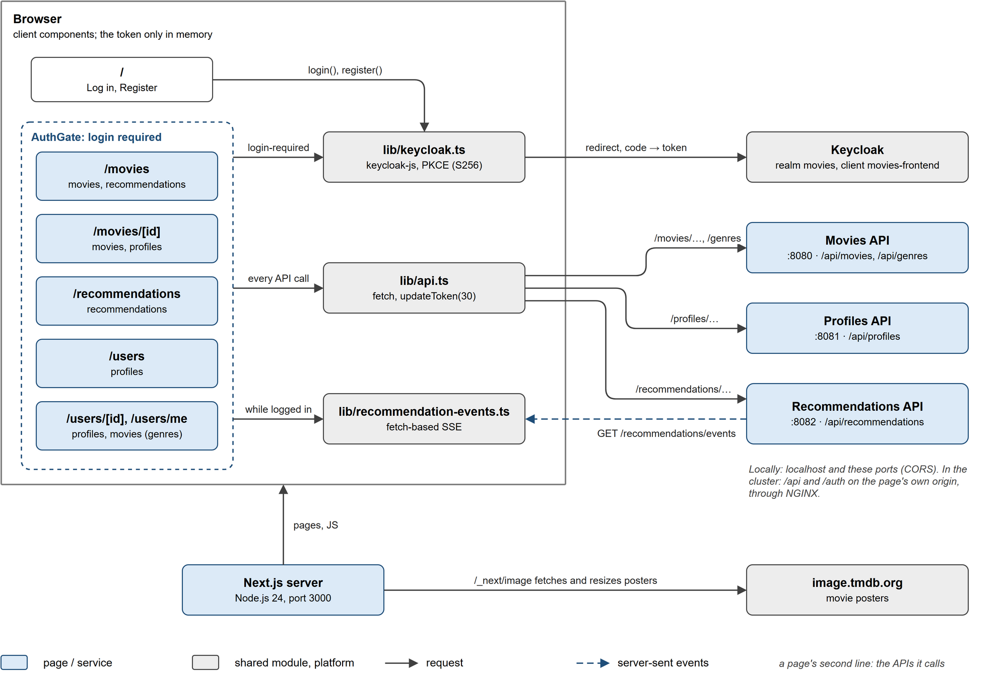
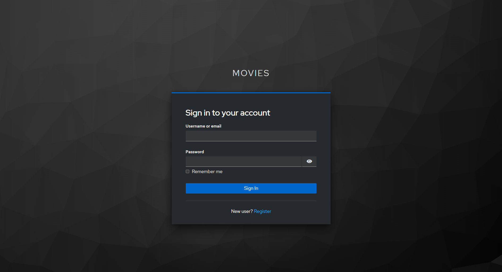
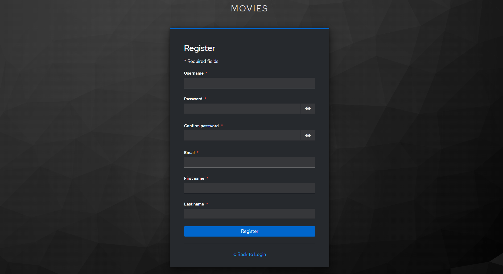
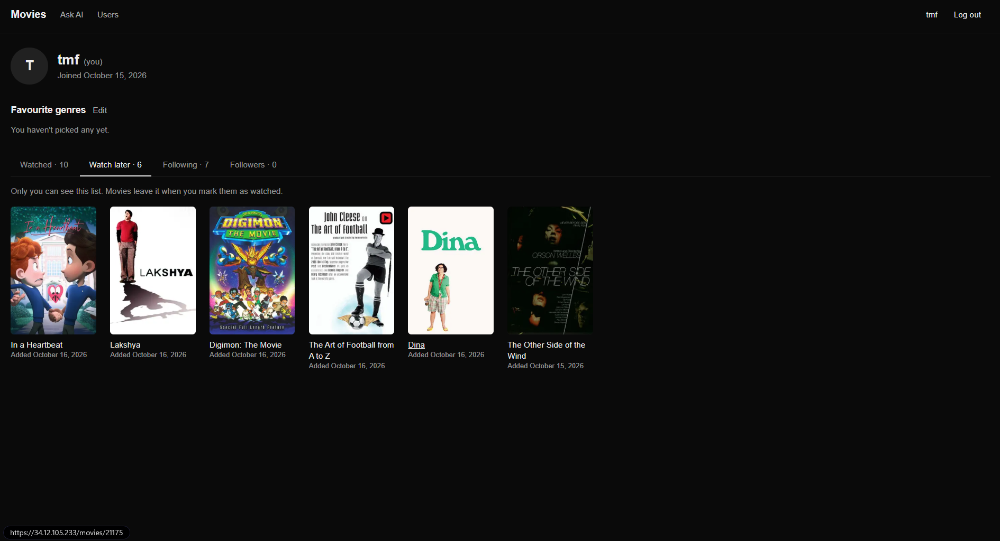

# Frontend

The website of the movie catalogue, where users browse and search movies, mark them as watched or save them for later, follow other users, and get recommendations from the language model. It is built with Next.js 16 (App Router), React 19, Tailwind CSS 4 and TypeScript, and logs users in through Keycloak with [`keycloak-js`](https://www.npmjs.com/package/keycloak-js).

Every page does its work in the browser. Each route's `page.tsx` only renders a client component (`"use client"`), and that component calls the APIs with `fetch` from the browser, with the user's access token. The Next.js server only serves the pages and their JavaScript, and resizes movie posters (see [Where it talks to](#where-it-talks-to)).

For the system as a whole, and the one-command setup, see the [root README](../README.md). The APIs it calls are described in [backend/README.md](../backend/README.md), and Keycloak and the cloud deployment in [infra/README.md](../infra/README.md).



## Pages

| Route | What the user can do |
|---|---|
| `/` | A top bar with **Log in** and **Register**. Both go to Keycloak's pages, and then on to `/movies`. |
| `/movies` | On top is **Recommended for you**, a row of ten movies picked for the user from their favourite genres, what they watched and saved, and what the people they follow watched. The first set takes a few minutes and appears on its own when it's ready. After that it is remade in the background whenever the profile, or what the people they follow watched, changes, and the row updates itself ("Picked 5 minutes ago · updating…"). Below it, all movies in a grid that loads more as you scroll. Above both are a search box (type, then press **Enter**, or press **Enter** on an empty box to show all movies again) and a **Sort by** dropdown with newest first (the default), oldest first, highest or lowest rated, title A–Z or Z–A, and, while searching, best match (the default for searches). The recommended row is hidden while searching. Search and sort are kept in the URL, e.g. `/movies?q=batman&sort=newest`, so reloading or going back keeps them. |
| `/movies/[id]` | One movie, with its poster, title, release date, rating and vote count, genres, description, links to its IMDb (when known) and TMDB pages, and **Mark as watched** and **Watch later**. Each button shows its state once clicked (**Watched ✓**, **On your watchlist ✓**) and undoes it when clicked again. Marking a movie as watched also takes it off the watchlist. If the profiles API is down, the two buttons are not shown. **← Back** returns to the page you came from, as you left it (see [Back navigation](#search-sort-and-back-navigation)). |
| `/recommendations` | On **Ask AI** you describe what you feel like watching (up to 300 characters), press **Ask** or **Enter** (**Shift+Enter** adds a line), and get ten movies you haven't watched or saved. It takes a few minutes, but you can leave the page meanwhile, and a notification says when it's ready or why it failed. Only one request runs at a time, so the box is disabled while one is being prepared. Your last five requests are listed on the left, and clicking one shows its answer again. The answer shown is in the URL (`?request=<id>`), so a notification can link to it. |
| `/users` | All users, by username, loading more as you scroll. To search, type the start of a username in the search box and press **Enter** (kept in the URL as `?q=`). Your own entry is marked "you". |
| `/users/[id]` | A user's profile, showing when they joined, their favourite genres, and tabs for the movies they've watched, who they follow and who follows them. Other users' profiles have **Follow** (**Following ✓** to undo). |
| `/users/me` | Your own profile, the same page with the id `me`. **Edit** picks your favourite genres from all 20, and an extra **Watch later** tab shows your watchlist, which nobody else sees. |

Every page under `/movies`, `/recommendations` and `/users` needs a login, so opening one while logged out goes to Keycloak's login page first and then back to that page. These pages share a top bar with **Movies**, **Ask AI** and **Users**, and on the right your username, which opens your profile, and **Log out**. **Log out** ends the Keycloak session too, so the next login asks for the password again, and returns to `/`.

### Screenshots

| | |
|---|---|
|  |  |
| Sign in, on Keycloak's page where **Log in** on `/` leads | Movies (`/movies`) |
|  |  |
| A movie (`/movies/[id]`) | Ask AI (`/recommendations`) |
|  |  |
| Users (`/users`) | A profile (`/users/[id]`) |
|  |  |
| Register, on Keycloak's page where **Register** on `/` leads | Your own watch-later list (`/users/me`), which only you see |

## How it works

### Login

The frontend uses `keycloak-js`, Keycloak's own browser library, with the realm `movies` and its public client `movies-frontend` (no client secret). It uses the authorization code flow with PKCE (`S256`):

1. **Log in** or **Register** on `/` (`app/auth-buttons.tsx`) sends the browser to Keycloak's login or sign-up page, with `/movies` as the address to come back to.
2. Every page under `app/(app)/` is wrapped in `AuthGate` (`app/(app)/auth-gate.tsx`), which initialises Keycloak with `onLoad: "login-required"`. A user who isn't logged in is sent to Keycloak's login page and comes back to the same URL.
3. Keycloak sends the browser back with a one-time code, which `keycloak-js` exchanges for an access token (a JWT valid for 5 minutes).
4. Right after the login, `AuthGate` asks profiles-service for the user's profile (`GET /profiles/me`). profiles-service creates a profile on a user's first request, so everyone who has logged in shows up under **Users**.
5. The pages call the APIs with `Authorization: Bearer <token>`. Before each call, `lib/api.ts` runs `keycloak.updateToken(30)`, which renews the token if it expires within 30 seconds.

The tokens only live in the page's memory and are never written to cookies or local storage (`keycloak-js` only keeps the login's `state` and PKCE verifier there during the redirect). Reloading a page therefore goes through Keycloak again. That is quick, because Keycloak still remembers the login and doesn't ask for the password. The Keycloak client is created once per page load and shared (`lib/keycloak.ts`). The library itself is loaded with a dynamic `import()`, so it never runs on the server.

### Infinite scrolling

The movie grid, the user list and the profile tabs all use `useInfinitePages` (`lib/use-infinite-pages.ts`). It loads page 0, 1, 2… of a paged API endpoint (24 movies or 30 users at a time) whenever an invisible element after the list comes within 800 pixels of the screen, until the last page. A fresh `IntersectionObserver` after each page means a screen that isn't full yet keeps loading until it is. A new search or sort remounts the list, which starts it over.

### Search, sort and back navigation

The search and sort of `/movies`, the search of `/users` and the answer shown on Ask AI are kept in the URL's query string, and changed with `router.replace`. Reloading the page, or coming back to it, therefore shows the same search.

**← Back** (`app/(app)/back-link.tsx`) uses `lib/app-history.ts`, which counts the app pages visited in this tab. If an earlier page of the app is in the tab's history, **← Back** acts like the browser's back button. If the page was opened directly, it goes to a fixed page instead (`/movies`).

Going back to `/movies` also brings the list back as it was. When a movie is clicked, `useInfinitePages` keeps the loaded movies, the page reached and the scroll position in memory, keyed by the sort and search, and restores them when the list is shown again with the same key. It keeps the last five such lists, only in this tab's memory. The user list and the profile tabs don't do this, and load again from the top.

### Recommendation events

While the user is logged in, `AuthGate` keeps the recommendations API's event stream open (`GET /recommendations/events`, in `lib/recommendation-events.ts`), to hear when a recommendation request is ready.

- It reads the stream with `fetch` and parses the `text/event-stream` format itself, because the browser's `EventSource` can't send the `Authorization` header.
- The server checks the token only when the stream opens, and tokens last five minutes, so the stream is closed and reopened with a fresh token every 4 minutes. A user who has logged out stops getting events.
- If the stream drops or the server closes it, it reopens after a pause that doubles each time (2 s, 4 s, 8 s…, at most 60 s), and the count resets once the server's `connected` event arrives.
- After a reconnection, it tells the pages, and those still waiting for an answer ask the API again, in case they missed an event meanwhile.

Pages subscribe to the events, so **Recommended for you** reloads when a profile set (`PROFILE`) is ready, and Ask AI when a typed request (`PROMPT`) is.

### Notifications

`app/(app)/recommendation-toasts.tsx` shows a notification in the bottom-right corner when an Ask AI request finishes, wherever the user is, except on Ask AI itself, which shows the answer directly. "Your Ask AI recommendations are ready" links to the answer and disappears after 15 seconds. A failure says why, links to Ask AI to try again, and stays until it is dismissed. A failed request is also shown on Ask AI itself, and dismissing it there is remembered in the browser's local storage, so it stays dismissed after a reload.

## Where it talks to

The browser calls three APIs and Keycloak. The addresses are compiled into the JavaScript at build time from the `NEXT_PUBLIC_*` variables (see [Configuration](#configuration)).

| What | Locally (`npm run dev`, or `just local-up`) | In the cluster |
|---|---|---|
| Movies API (`/movies`, `/movies/search`, `/movies/{id}`, `/genres`) | `http://localhost:8080` | `/api/movies`, `/api/genres` |
| Profiles API (`/profiles/...`) | `http://localhost:8081` | `/api/profiles` |
| Recommendations API (`/recommendations/...`, including the event stream) | `http://localhost:8082` | `/api/recommendations` |
| Keycloak | `http://localhost:8180` | `/auth` |

Locally, the pages (on `localhost:3000`) call the APIs on other origins, so the APIs allow `http://localhost:3000` through CORS. They set it with `%dev.quarkus.http.cors.origins` in each API's `application.properties` when the services run by hand, and with `QUARKUS_HTTP_CORS_ORIGINS` in `backend/compose.yaml` in Docker. Keycloak's `movies-frontend` client allows the redirect URI `http://localhost:3000/*` and the web origin `http://localhost:3000` (`infra/keycloak/movies-realm.json`).

In the cluster, the image is built with relative addresses, `/api` and `/auth` (the defaults in `frontend/Dockerfile`). Those are paths on the page's own origin, which the NGINX reverse proxy (`infra/k8s/nginx.yaml.j2`) sends to each API and to Keycloak, so no CORS is needed and the same image works at any address. NGINX doesn't buffer the event stream. Ansible replaces `http://localhost:3000` in the realm with the public address before Keycloak imports it, so the login redirects back to the right place. See [infra/README.md](../infra/README.md).

Posters come from TMDB (`https://image.tmdb.org/t/p/...`). They go through Next.js's image component, so the browser asks the Next.js server (`/_next/image`), which fetches the poster from `image.tmdb.org` and resizes it. `next.config.ts` allows only that host. Most of the dataset's posters no longer exist on TMDB, so most movies show "No poster".

## Running it

### In Docker, with the rest of the system

From the project root, `just local-first-up` (the first time) or `just local-up` starts everything, the frontend last, then open `http://localhost:3000` and register. See the [root README](../README.md#quick-start). The frontend's part is `frontend/compose.yaml`, which defines one container, `frontend`, built from `frontend/Dockerfile` with the `localhost` addresses as build arguments, published on port 3000, capped at 512 MB, with a health check that fetches the home page with `node` (the image has no `curl`). The browser calls the APIs, not the container, so it doesn't join the other services' network.

After changing the frontend's code, rebuild it from the project root:

```bash
docker compose -f frontend/compose.yaml up -d --build
```

### By hand, for development

Running the frontend by hand gives live reload. Keycloak and the movies and profiles APIs must be running, started as in [backend/README.md](../backend/README.md) and [infra/README.md](../infra/README.md). Without the recommendation services, everything works except the recommendations. Don't run the Docker container at the same time, because both use port 3000.

```bash
cd frontend
npm install
npm run dev        # http://localhost:3000
```

| Command | What it does |
|---|---|
| `npm run dev` | The development server, with live reload, on port 3000 (`npm run dev -- -p <port>` for another) |
| `npm run build` | The production build, including the standalone server in `.next/standalone` |
| `npm start` | Serves the production build |
| `npm run lint` | ESLint, with Next.js's Core Web Vitals and TypeScript rules (`eslint.config.mjs`) |

### Node.js 24 with nvm

The frontend is developed with Node.js 24 LTS, the version the Docker image uses, but any version from 20.9 works. On Debian or Ubuntu, or on macOS:

```bash
curl -o- https://raw.githubusercontent.com/nvm-sh/nvm/v0.40.1/install.sh | bash
source ~/.bashrc
nvm install --lts
nvm alias default 'lts/*'
```

The installer adds nvm to `~/.bashrc`, so `node` and `npm` are available in every new terminal. Check:

```bash
node -v    # v24.x
npm -v
```

### Configuration

The defaults match the local setup, so nothing needs configuring. To point the frontend elsewhere when running it by hand, set these in `frontend/.env.local`. They are compiled into the browser code, so restart `npm run dev` (or run `npm run build` again) after changing them.

| Variable | Default (`npm run dev`) | Default in the Docker image |
|---|---|---|
| `NEXT_PUBLIC_MOVIES_API_URL` | `http://localhost:8080` | `/api` |
| `NEXT_PUBLIC_PROFILES_API_URL` | `http://localhost:8081` | `/api` |
| `NEXT_PUBLIC_RECOMMENDATIONS_API_URL` | `http://localhost:8082` | `/api` |
| `NEXT_PUBLIC_KEYCLOAK_URL` | `http://localhost:8180` | `/auth` |
| `NEXT_PUBLIC_KEYCLOAK_REALM` | `movies` | `movies` |
| `NEXT_PUBLIC_KEYCLOAK_CLIENT_ID` | `movies-frontend` | `movies-frontend` |

The first column is the fallback in `lib/api.ts` and `lib/keycloak.ts`, and the second is the `ARG` defaults in `frontend/Dockerfile`. `frontend/compose.yaml` sets the first four back to the `localhost` addresses. `.env.local` doesn't reach the Docker image (`.dockerignore` excludes `.env*`), so for the image use `--build-arg`, or `build.args` in `frontend/compose.yaml`.

Other settings that involve the frontend:

| Setting | Default | Where to change it |
|---|---|---|
| Frontend port | `3000` | `npm run dev -- -p <port>`, or `ports` in `frontend/compose.yaml`. Keycloak's `movies-frontend` client and the APIs' CORS origins name `http://localhost:3000`, so update them too |
| API ports | `8080`, `8081`, `8082` | Changing them also means changing the `NEXT_PUBLIC_*_API_URL` variables above |
| Keycloak port | `8180` | `NEXT_PUBLIC_KEYCLOAK_URL`, besides Keycloak's own settings ([infra/README.md](../infra/README.md)) |

### Building the image

```bash
docker build -t frontend frontend    # from the project root
```

The image (`frontend/Dockerfile`) is built in three stages on `node:24-slim`. The first runs `npm ci`, the second `npm run build`, and the final stage keeps only the standalone server (`output: "standalone"` in `next.config.ts`), `public/` and `.next/static`. It runs `node server.js` as the `node` user on port 3000, with telemetry off. Without build arguments it calls `/api` and `/auth` on its own origin, for the cluster. The cloud deployment's images are built and pushed by `infra/build-images.sh` (see [infra/README.md](../infra/README.md)).

### Running on a remote machine

If the project runs on another machine (a VM, or through IntelliJ remote development) and your browser runs on your own computer, forward ports 3000, 8080, 8081, 8082 and 8180 to the **same port numbers** on your computer. Keycloak's login redirects and tokens name `http://localhost:8180` and `http://localhost:3000` exactly, so different local port numbers break the login.

### Troubleshooting

| Problem | Fix |
|---|---|
| **Log in** or **Register** does nothing, or Keycloak's page doesn't load when opening a page under `/movies`, `/recommendations` or `/users` | The browser can't reach Keycloak at `http://localhost:8180`. Start it, and forward port 8180 if you use a remote machine, as [Running on a remote machine](#running-on-a-remote-machine) explains. |
| The movies page says `Couldn't load movies: Failed to fetch` | The browser couldn't reach the movies API. Check that it's running, and that port 8080 is forwarded if you use a remote machine. If the browser console mentions CORS, the page's origin isn't in the APIs' allowed CORS origins. |
| The Users page or a profile says `Failed to fetch` | The profiles API isn't reachable. Start it, and forward port 8081 if you use a remote machine. |
| A profile page or button says `The movies service isn't available` | profiles-service couldn't reach movies-service, so start the movies API. |
| **Recommended for you** says "Recommendations are unavailable right now" | The recommendations API isn't reachable on port 8082. Everything else works without it. |
| **Recommended for you** stays at "Picking movies for you" for many minutes | The worker is still on it, or on other users' jobs first, since each set takes minutes on a CPU. See [backend/README.md](../backend/README.md) for the worker and the model. |
| The profiles or recommendations API returns `401` even though the movies API works | Your Keycloak predates that API's audience. Run `./infra/keycloak/add-profiles-service.sh` and then `./infra/keycloak/add-recommendations.sh` from the project root if you haven't, then log out and in again. |
| Most movies show "No poster" | This is expected, because TMDB has since deleted most of the poster files the 2017 dataset points to (only about 1 in 10 still exists). |
| `Bind for 0.0.0.0:3000 failed: port is already allocated` | A frontend started with `npm run dev` is still running while `just local-up` starts the container, or the other way round. Stop one of the two. |
| Port 3000 is in use | Find what's using it with `ss -ltnp \| grep :3000` (or `lsof -i :3000`), often a frontend you started earlier, and stop it. Or use another port, as in [Configuration](#configuration). |

## Code layout

| Path | Contents |
|---|---|
| `app/layout.tsx` | The root layout, with the page title, Geist fonts (`next/font/google`) and Tailwind's `globals.css` |
| `app/page.tsx`, `app/auth-buttons.tsx` | The landing page `/`, with **Log in** and **Register** |
| `app/(app)/layout.tsx`, `auth-gate.tsx` | Everything that needs a login, which is `AuthGate` (login, top bar, event stream) and the `useKeycloak()` hook the pages use |
| `app/(app)/back-link.tsx` | **← Back** |
| `app/(app)/recommendation-toasts.tsx` | The Ask AI notifications |
| `app/(app)/movies/` | `/movies`, with the grid and search (`movies-browser.tsx`), the sort options, **Recommended for you** (`recommended-row.tsx`), the movie card and poster |
| `app/(app)/movies/[id]/` | `/movies/[id]`, with one movie and **Mark as watched** / **Watch later** |
| `app/(app)/recommendations/` | `/recommendations`, which is Ask AI (`ask-ai.tsx`) |
| `app/(app)/users/` | `/users`, with the user search and the reusable user list |
| `app/(app)/users/[id]/` | `/users/[id]` and `/users/me`, with the profile, its tabs, **Follow** and the genre editor |
| `lib/api.ts` | Every API call and the types it returns, with the token refresh and error handling (`ApiError`) |
| `lib/keycloak.ts` | The shared Keycloak client and its configuration |
| `lib/recommendation-events.ts` | The event stream and its subscribers |
| `lib/use-infinite-pages.ts` | The infinite-scrolling hook, and the in-memory lists for back navigation |
| `lib/app-history.ts` | Counts the app pages visited in this tab, for **← Back** |
| `lib/time-ago.ts` | "5 minutes ago", "yesterday"… |
| `next.config.ts` | Standalone output, and TMDB as the only allowed image host |
| `Dockerfile`, `compose.yaml` | The image, and the container for the local setup |
