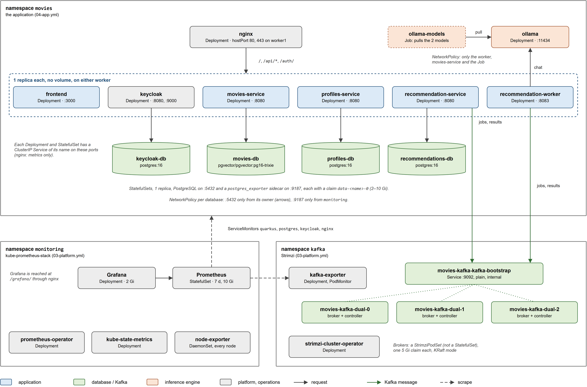
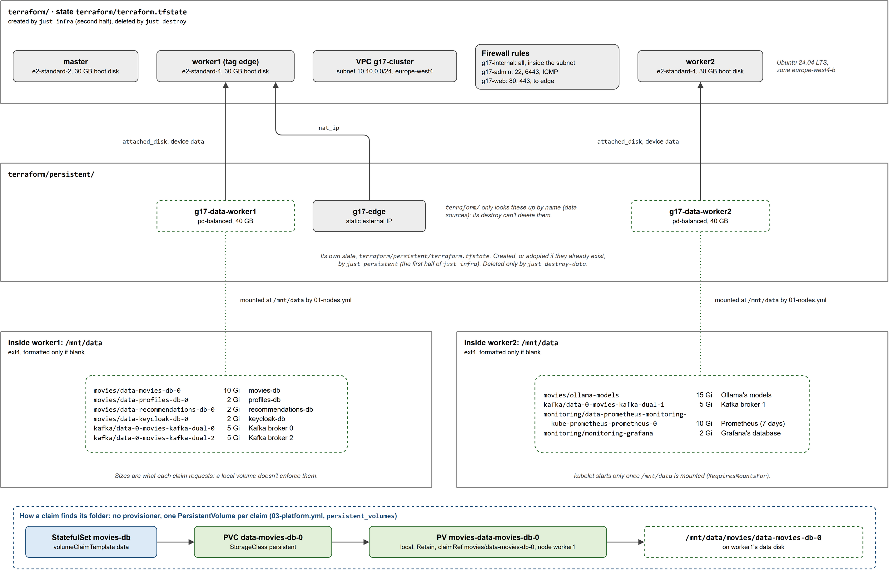
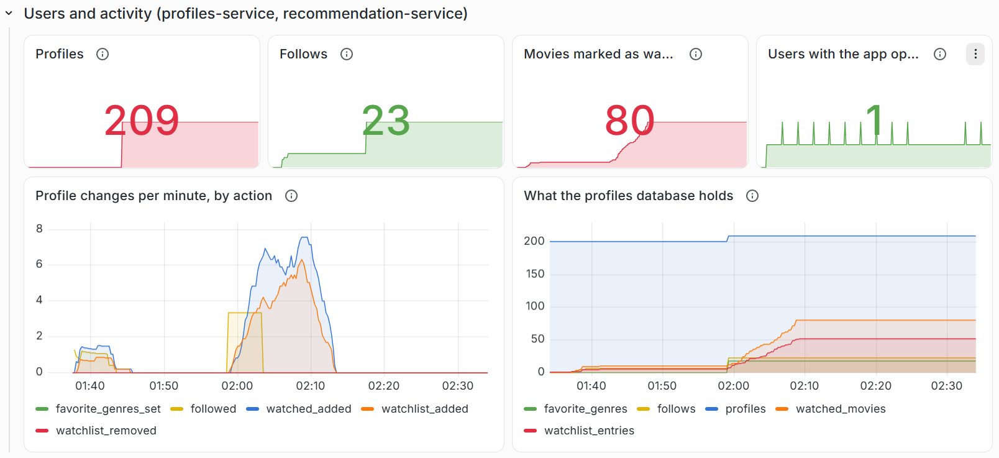
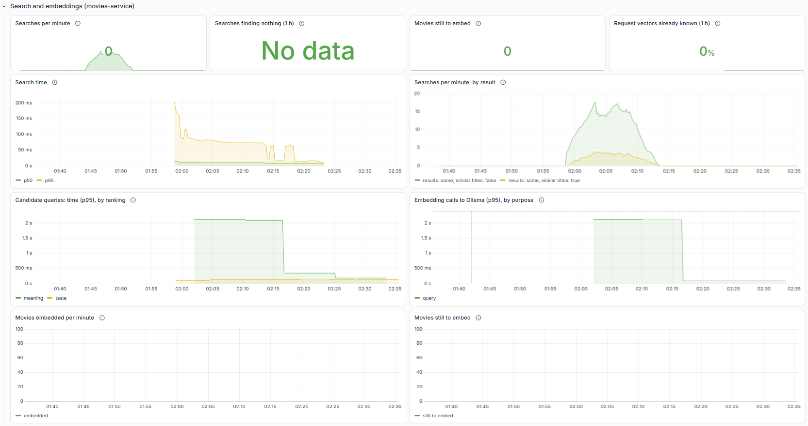

# Infrastructure

Everything the application runs on, in two setups:

- In Google Cloud, on a self-hosted Kubernetes cluster built from nothing. Terraform creates the VMs and the network, and Ansible installs Kubernetes (kubeadm, containerd, Calico, as in lab 4) and deploys everything onto it. Most of this README is about this setup.
- On your own machine, in Docker Compose, where `compose.yaml` in this folder starts the databases, Kafka, Ollama and Keycloak. See [Running locally with Docker Compose](#running-locally-with-docker-compose).


| Folder or file | What |
|---|---|
| `mgmt/` | The management container, with Terraform, Ansible, kubectl and gcloud, so your computer only needs Docker |
| `terraform/` | The VPC, firewall and VMs (1 control plane + 2 workers by default), and Ansible's inventory |
| `terraform/persistent/` | One data disk per worker (every volume) and the static IP, which outlive the VMs, in their own Terraform state. See [Persistent data](#persistent-data) |
| `ansible/` | The playbooks `01-nodes`, `02-cluster` (Kubernetes), `03-platform` (volumes, Strimzi, Prometheus/Grafana), `04-app` (the application), and their settings in `group_vars/all.yml` |
| `k8s/` | The Kubernetes manifests, as templates Ansible fills in, and Grafana's dashboard (`dashboards/movies.json`) |
| `build-images.sh` | Builds the five application images and pushes them to a registry |
| `justfile` | The cloud deployment's commands (see [Command reference](#command-reference)) |
| `evidence/` | The persistence test, with snapshots of the application's state and their comparison. See [Testing persistence](#testing-persistence) and [evidence/README.md](evidence/README.md) |
| `loadtest/` | The load test of the report's evaluation (k6 in a pod on the control plane). See [loadtest/README.md](loadtest/README.md) |
| `compose.yaml`, `init/`, `keycloak/` | The local infrastructure in Docker, the Keycloak realm that both setups import, and the scripts that update an older local realm |

## The VMs

Three VMs in `europe-west4-b` (`gcp_zone`), all Ubuntu 24.04 LTS, in the VPC `g17-cluster` with the subnet `10.10.0.0/24` (`terraform/network.tf`, `terraform/servers.tf`):

| VM | Machine type | Disks | Role | What runs there |
|---|---|---|---|---|
| `master` | `e2-standard-2` (`master_machine_type`) | 30 GB boot disk | Kubernetes control plane | The API server, etcd, scheduler and controller manager. kubeadm taints it `NoSchedule`, so no application pod runs here. Only the k6 pod of the load test tolerates it |
| `worker1` | `e2-standard-4` (`worker_machine_type`) | 30 GB boot disk (`disk_size_gb`) + data disk `g17-data-worker1`, 40 GB | Worker and **edge node**, with network tag `edge`, the static IP `g17-edge` and node label `movies/edge=true` | NGINX (the only public entry point), the four PostgreSQL pods, Kafka brokers 0 and 2 |
| `worker2` | `e2-standard-4` | 30 GB boot disk + data disk `g17-data-worker2`, 40 GB | Worker | Ollama, Kafka broker 1, Prometheus, Grafana |

The pods without a volume (the frontend, Keycloak, the four services, the operators, kube-state-metrics, Kafka Exporter) go on either worker, wherever the scheduler puts them. Each volume-free pod has one replica and no anti-affinity or topology spread constraints. On 15/10/2026 `kubectl -n movies get pods -o wide` showed all six stateless Deployments on worker1, next to the databases, which made worker1 the bottleneck of the load test ([loadtest/README.md → Results](loadtest/README.md#results-15102026)). On the other hand, pods with volumes run on the worker whose data disk holds that volume (`persistent_volumes` in `ansible/group_vars/all.yml`), and NGINX has `nodeSelector: movies/edge: "true"` (`k8s/nginx.yaml.j2`). The edge node is the first worker (`edge_node`, which Terraform writes into `ansible/inventory.ini`). Calico, kube-proxy and node-exporter run on every node.

Every disk is `pd-balanced`. The master and worker2 have ephemeral public addresses, which can change when the VMs are stopped and started, while worker1 always has the static IP.

The firewall (`terraform/network.tf`) has three rules:

| Rule | From | Allows |
|---|---|---|
| `g17-internal` | The subnet | Everything between the VMs, including the Kubernetes API, kubelets, Calico's BGP and its IP-in-IP tunnels |
| `g17-admin` | `admin_cidrs` (default `0.0.0.0/0`, which you should narrow to your address) | SSH (22), the Kubernetes API (6443), ICMP |
| `g17-web` | Anywhere | 80 and 443, only to the VM tagged `edge` |

The versions (`ansible/group_vars/all.yml`) are Kubernetes 1.35, Calico v3.32.2, Helm v4.3.0, Strimzi 1.2.0 with Kafka 4.3.1, kube-prometheus-stack 91.8.2. The pod network is `192.168.0.0/16` (Calico's default).

## What runs in the cluster

The cluster has three namespaces. `movies` holds the application, deployed by `04-app.yml`. `kafka` (Strimzi and the Kafka cluster) and `monitoring` (kube-prometheus-stack) are both installed by `03-platform.yml`.



### Namespace `movies`

Every workload has one replica. The five application images are `<image_registry>/<name>:<image_tag>` (now `docker.io/tiagog17/...:v1`), pulled with `imagePullPolicy: Always`.

| Workload | Kind | Image | Port (Service) | Volume | Requests → limit (memory) | Probes |
|---|---|---|---|---|---|---|
| `nginx` | Deployment, `Recreate`, on the edge node | `nginx:stable-alpine` + `nginx/nginx-prometheus-exporter:1.5.3` | hostPort 80 and 443, and a Service only for metrics, on 9113 | ConfigMap `nginx`, Secret `movies-tls` | 50m, 64Mi → 256Mi (exporter 10m, 16Mi → 64Mi) | TCP 443 (readiness) |
| `frontend` | Deployment | `frontend` | 3000 | none | 50m, 128Mi → 512Mi | `GET /` (readiness) |
| `keycloak` | Deployment | `quay.io/keycloak/keycloak:26.7.4` | 8080, management 9000 | ConfigMap `keycloak-realm` (the realm to import) | 250m, 768Mi → 1536Mi | `/health/*` on 9000 (startup, readiness, liveness) |
| `movies-service` | Deployment | `movies-service` | 8080 | none | 100m, 384Mi → 768Mi | `/q/health/*` (startup, readiness, liveness) |
| `profiles-service` | Deployment | `profiles-service` | 8080 | none | 100m, 384Mi → 768Mi | the same |
| `recommendation-service` | Deployment | `recommendation-service` | 8080 | none | 100m, 384Mi → 768Mi | the same |
| `recommendation-worker` | Deployment | `recommendation-worker` | 8083 | none | 100m, 384Mi → 768Mi | the same |
| `ollama` | Deployment, `Recreate` | `ollama/ollama:0.35.0` | 11434 | claim `ollama-models`, 15Gi, at `/root/.ollama` | 2 CPUs, 3Gi → 5Gi | `GET /` (readiness) |
| `ollama-models` | Job (replaced on every `just app`) | `ollama/ollama:0.35.0` | none | none | none set | none |
| `movies-db` | StatefulSet | `pgvector/pgvector:pg16-trixie` + `postgres-exporter:v0.20.1` | 5432, metrics 9187 | claim `data-movies-db-0`, 10Gi | 100m, 256Mi → 1Gi (exporter 10m, 32Mi → 128Mi) | `pg_isready` (readiness) |
| `profiles-db`, `recommendations-db`, `keycloak-db` | StatefulSet each | `postgres:16` + the same exporter | 5432, 9187 | claim `data-<name>-0`, 2Gi each | the same | the same |

- The Java services get `JAVA_MAX_MEM_RATIO=50`, so the heap is at most half the memory limit. Their startup probe allows 5 minutes for movies-service (Flyway's first migration of 45,000 movies) and 3 minutes for the others.
- Ollama runs with `OLLAMA_NUM_PARALLEL=1`, `OLLAMA_MAX_LOADED_MODELS=2` and `OLLAMA_KEEP_ALIVE=10m`. The Job pulls `ollama_chat_model` (`qwen2.5:3b`) and `ollama_embedding_model` (`nomic-embed-text`) into it (a model already there is only checked).
- NGINX and Ollama use the `Recreate` strategy, because NGINX holds the node's ports 80 and 443 and Ollama's volume can only be mounted by one pod. NGINX restarts when its configuration changes (the `movies/config-hash` annotation).
- The Secret `movies-secrets` holds every password and client secret, generated into `ansible/.secrets/` on the first run (`k8s/namespace.yaml.j2`). `movies-tls` holds the TLS certificate, and `registry` the pull secret, only for a private registry.

NetworkPolicies are firewall rules for pods. They are unrelated to a Kubernetes Ingress resource, which the project doesn't use, since NGINX is a plain Deployment. Each policy below only filters the connections coming into the pods it selects (`policyTypes: [Ingress]`), and pods without a policy accept connections from anywhere in the cluster.

| Policy | Selects | Allows in |
|---|---|---|
| `movies-db`, `profiles-db`, `recommendations-db`, `keycloak-db` | That database's pod | 5432 only from its owner (movies-service, profiles-service, recommendation-service, Keycloak), and 9187 only from the `monitoring` namespace |
| `ollama` | The Ollama pod | 11434 only from recommendation-worker, movies-service and the `ollama-models` Job |

### Namespace `kafka`

| Workload | Kind | Notes |
|---|---|---|
| `strimzi-cluster-operator` | Deployment (Helm chart) | Runs Kafka from the `Kafka` and `KafkaNodePool` resources in `k8s/kafka.yaml.j2` |
| `movies-kafka-dual-0`, `-1`, `-2` | Pods of a StrimziPodSet (Strimzi's replacement for a StatefulSet) | `kafka_replicas: 3` nodes in KRaft mode, each both broker and controller. One 5Gi claim each (`data-0-movies-kafka-dual-<n>`). Heap 256 to 512 MB, with 200m, 768Mi → 1Gi |
| `movies-kafka-kafka-exporter` | Deployment | Consumer-group lag and topic offsets for Prometheus, with 50m, 64Mi → 256Mi |

Clients connect to the Service `movies-kafka-kafka-bootstrap.kafka.svc.cluster.local:9092` (plain, internal listener). Topics are created on first use with 6 partitions and 3 copies (`min.insync.replicas` 2), so they survive one broker down. `kafka_replicas: 1` saves memory, with 1 copy.

### Namespace `monitoring`

kube-prometheus-stack, release `monitoring` (`k8s/platform/kube-prometheus-stack.values.yaml.j2`):

| Workload | Kind | Notes |
|---|---|---|
| Prometheus | StatefulSet (made by the Prometheus operator), on worker2 | Scrapes every 15 s and keeps 7 days in a 10Gi claim, with 200m, 512Mi → 1536Mi. Service `monitoring-kube-prometheus-prometheus:9090` |
| Grafana (`monitoring-grafana`) | Deployment, `Recreate`, on worker2 | Keeps its database in a 2Gi claim, is served at `/grafana/` and loads dashboards from ConfigMaps labelled `grafana_dashboard=1` |
| Prometheus operator, kube-state-metrics | Deployments | |
| node-exporter | DaemonSet | One per node |

Alertmanager is disabled, and so are the etcd, controller-manager, scheduler and kube-proxy targets, because kubeadm binds their metrics to `127.0.0.1`, out of Prometheus's reach.

## What's public, and what isn't

Only NGINX is reachable from the Internet, on the edge node's ports 80 (redirects to HTTPS) and 443. It routes:

| Path | Goes to |
|---|---|
| `/` | frontend |
| `/api/movies`, `/api/genres` | movies-service (`/movies`, `/genres`) |
| `/api/profiles` | profiles-service (`/profiles`) |
| `/api/recommendations` | recommendation-service (`/recommendations`, including the `/events` stream, unbuffered) |
| `/auth/` | Keycloak (login, registration, admin console) |
| `/grafana/` | Grafana (its own login) |

The APIs sit under `/api` because the frontend's pages also use `/movies`, `/recommendations` and `/users`. Nothing else is routed, so there is no route to the services' `/q/...` (health, metrics, Swagger UI), profiles-service's `/internal/...`, the worker, Ollama, the databases, Kafka or Prometheus. They don't need a route to be monitored, because Prometheus runs inside the cluster and scrapes them on their internal Services. The NetworkPolicies above also enforce that each database accepts connections only from its own service.

Keycloak's browser library refuses to work over plain HTTP (it needs the browser's Web Crypto API, which only exists on HTTPS pages), so NGINX always serves HTTPS. Without a certificate of your own, the playbook makes a self-signed one for the static IP, so the browser warns once and works after you accept it. See [Using a real certificate](#using-a-real-certificate).

### How the application is configured here

The services read the same environment variables their `application.properties` list for production, and the manifests in `k8s/` set them as follows:

- **Databases.** There is one PostgreSQL StatefulSet per service (`movies-db` with pgvector, `profiles-db`, `recommendations-db`) and one for Keycloak (`keycloak-db`, which locally shares the movies server). The first `just app` restores `data/movies_dump.sql` into `movies-db` before movies-service ever starts.
- **Kafka.** The services reach it at `movies-kafka-kafka-bootstrap.kafka.svc.cluster.local:9092` (`KAFKA_BOOTSTRAP_SERVERS`).
- **Keycloak.** It runs in production mode behind NGINX at `/auth`, over plain HTTP inside the cluster, because NGINX ends TLS and says so in `X-Forwarded-*` headers. The realm is imported from `keycloak/movies-realm.json` on the first start, with the public URL in place of `http://localhost:3000` and generated secrets in place of the service accounts' dev secrets. As locally, later changes to the file don't reach an existing realm.
- **Tokens.** Their issuer is the public URL (`https://<IP>/auth/realms/movies`). The services fetch Keycloak's keys over the cluster network (`http://keycloak.movies.svc.cluster.local:8080/auth/realms/movies`), and still check that issuer.
- **Frontend.** It is built with `/api` and `/auth` as its API and Keycloak addresses (relative, so the image works at any address), and served by Next.js's standalone server.

## Running locally with Docker Compose

The root [README](../README.md) starts everything with `just local-first-up` (the first time), `just local-up` and `just local-down`. Underneath, those recipes run the three Compose projects below.

### The three Compose projects

| Project | File | Contains |
|---|---|---|
| `infra` | `infra/compose.yaml` | `postgres` (movies and Keycloak), `profiles-db`, `recommendations-db`, `kafka`, `ollama`, `ollama-models` (downloads the models, then exits), `keycloak` |
| `backend` | `backend/compose.yaml` | `movies-service`, `profiles-service`, `recommendation-service`, `recommendation-worker` |
| `frontend` | `frontend/compose.yaml` | `frontend` |

They share one network, `movies-net`, which `infra/compose.yaml` creates under that fixed name, and the other two join it as an external network. Compose can't make one project wait for another, so the root `justfile` starts them in order and waits for each to be healthy. Containers reach each other by name (`postgres`, `keycloak`, `kafka:29092`...), while your browser uses the published ports on `localhost`.

### What `infra/compose.yaml` starts

```bash
docker compose -f infra/compose.yaml up -d
```

| Container | Image | Port | Volume | What |
|---|---|---|---|---|
| `postgres` | `pgvector/pgvector:pg16-trixie` | 5432 | `postgres_data` | movies-service's database `movies` (user and password `postgres`), with pgvector for search by meaning, and also Keycloak's `keycloak` database |
| `profiles-db` | `postgres:16` | 5433 | `profiles_data` | profiles-service's database `profiles` (user and password `profiles`) |
| `recommendations-db` | `postgres:16` | 5434 | `recommendations_data` | recommendation-service's database (database, user and password `recommendations`) |
| `kafka` | `apache/kafka:4.3.1` | 9092 (`kafka:29092` from containers) | `kafka_data` | The queue between the recommendations API and its worker, with one broker in KRaft mode, 6 partitions per topic and heap 256 to 512 MB |
| `ollama` | `ollama/ollama:0.35.0` | 11434 | `ollama_models` | Runs the language models, the chat model for the worker and the embedding model for movies-service, both loaded at once. Memory capped at `OLLAMA_MEMORY_LIMIT` (4 GB) |
| `ollama-models` | `ollama/ollama:0.35.0` | | (Ollama's) | Downloads `qwen2.5:3b` (about 2 GB) and `nomic-embed-text` (about 270 MB) the first time, then exits. Later runs find them and exit at once |
| `keycloak` | `quay.io/keycloak/keycloak:26.7.4` | 8180 | none (its data is in `postgres`) | Accounts and login, in dev mode. Imports the `movies` realm from `keycloak/` on its first start, and needs about 30 seconds to start |

`docker ps` shows each one as `healthy` when it's ready. `docker logs -f ollama-models` shows the download's progress, and `docker exec ollama ollama list` what's downloaded. The data is kept in the five Docker volumes, so it survives restarts and `just local-down`.

The `keycloak` database is created by `init/01-keycloak.sql`, but only when the `postgres_data` volume is new. **If your database volume existed before Keycloak was added**, create it once by hand, then start Keycloak (and the other containers that didn't exist yet when you set up):

```bash
docker exec -i postgres psql -U postgres < infra/init/01-keycloak.sql
docker compose -f infra/compose.yaml up -d
```

**If your `postgres` container was created before search by meaning**, it runs the plain `postgres:16` image. `docker compose -f infra/compose.yaml up -d postgres` recreates it with `pgvector/pgvector:pg16-trixie` and keeps its volume, so no data is lost. That image is built on the same Debian release as `postgres:16`, so text keeps sorting the same way. The `pg16` tag without `-trixie` is built on an older one, which would leave existing text indexes out of order.

**If your Keycloak was set up before the profiles API or the recommendation services existed**, `keycloak/add-profiles-service.sh` and then `keycloak/add-recommendations.sh` add what's missing to the realm and keep every account (see the [backend README](../backend/README.md)).

### Load the movies data (first time only)

`just local-first-up` does this for you, and skips it if the data is already there. By hand, do it **before you start the movies API for the first time**, because on an empty database the movies API creates empty tables on startup and the restore then clashes with them.

```bash
docker exec -i postgres psql -U postgres -d movies < data/movies_dump.sql
docker exec postgres psql -U postgres -d movies -c "select count(*) from movies.movie"    # 45430
```

This runs `psql` inside the container, so you don't need it installed locally. It takes a few seconds and creates the `movies` schema with its tables, view and indexes. The search columns aren't in the dump, and the API adds them the first time it starts. The dump was produced by `pg_dump` 17, so Postgres 16 prints one harmless error, `unrecognized configuration parameter "transaction_timeout"`. Run the restore only once, into an empty database, because a second restore fails when the tables already exist.

### Reset the data

Run `just local-down` first if you started everything with `just` (otherwise the backend containers keep running), then:

```bash
docker compose -f infra/compose.yaml down -v
```

**This deletes every user account, profile, recommendation and downloaded model.** The next `just local-first-up` loads the movies again.

### Memory

The four services are capped at 768 MB each (`backend/compose.yaml`), the frontend at 512 MB and Ollama at 4 GB, so the stack needs several gigabytes of memory. On Windows with WSL 2, give it at least 10 GB. The model is the biggest part, at about 2.5 GB for `qwen2.5:3b` or 750 MB for `qwen2.5:0.5b`, and it is unloaded after 10 idle minutes. Keycloak takes about 600 MB and Kafka 500 MB.

### Settings

Nothing needs configuring if you keep the defaults. Set these in your shell before the first `docker compose up` (or `just local-first-up`):

| Setting | Default | How to change it |
|---|---|---|
| Movies database name, user and password | `movies`, `postgres`, `postgres` | `POSTGRES_DB`, `POSTGRES_USER`, `POSTGRES_PASSWORD`. Also change the matching `%dev.quarkus.datasource.*` lines in movies-service's `application.properties` |
| Profiles database user and password | `profiles`, `profiles` | `PROFILES_DB_USER`, `PROFILES_DB_PASSWORD`, and `%dev.quarkus.datasource.*` in profiles-service's |
| Recommendations database user and password | `recommendations`, `recommendations` | `RECOMMENDATIONS_DB_USER`, `RECOMMENDATIONS_DB_PASSWORD`, and `%dev.quarkus.datasource.*` in recommendation-service's |
| Database ports | `5432`, `5433`, `5434` | `ports` in `infra/compose.yaml`, and `%dev.quarkus.datasource.jdbc.url` in the matching service's `application.properties` |
| The chat model | `qwen2.5:3b` | `OLLAMA_MODEL` (it downloads that one), and `RECOMMENDATION_MODEL` set to the same for the worker |
| The embedding model | `nomic-embed-text` | `OLLAMA_EMBEDDING_MODEL`, and `EMBEDDING_MODEL` set to the same for movies-service. Changing it embeds every movie again |
| Ollama's memory limit, and how long an idle model stays loaded | `4g`, `10m` | `OLLAMA_MEMORY_LIMIT`, `OLLAMA_KEEP_ALIVE` |
| Keycloak's admin user and password | `admin`, `admin` | `KEYCLOAK_ADMIN`, `KEYCLOAK_ADMIN_PASSWORD` |
| Keycloak's port | `8180` | `ports` and `KC_HOSTNAME` in `infra/compose.yaml`, `%dev.quarkus.oidc.auth-server-url` in the APIs' `application.properties`, `KEYCLOAK_REALM_URL` for the recommendation services' own logins, and `NEXT_PUBLIC_KEYCLOAK_URL` for the frontend |

The backend containers read `POSTGRES_*`, `PROFILES_DB_*`, `RECOMMENDATIONS_DB_*`, `OLLAMA_MODEL` and `OLLAMA_EMBEDDING_MODEL` from your environment too. Their ports and addresses are fixed in `backend/compose.yaml`.

## One-time setup

Everything here is done once per person (or per Google Cloud project). The commands are for macOS with [Homebrew](https://brew.sh). On Linux, install the same tools with your package manager.

### Tools on your computer

- **Docker Desktop**, started (the whale icon in the menu bar). It builds the images and runs the management container, and nothing else is installed locally.
- **just**, which runs the commands in `infra/justfile`. Install it with `brew install just`. Without it, copy the commands from `justfile` by hand.
- **Google Cloud CLI**, only for the setup below. Install it with `brew install --cask gcloud-cli`. Homebrew puts it in `/opt/homebrew/share/google-cloud-sdk/bin`, so add that to your `PATH` or call it by that path.

### A Google Cloud project for Terraform

Log in with the Google account that has the credits (this opens the browser):

```bash
gcloud auth login
```

Create a project for the deployment, with billing, and the APIs it uses. Project IDs are global, so pick a unique one, e.g. with a random suffix.

```bash
PROJECT=psia26-g17-$(LC_ALL=C tr -dc 'a-z0-9' </dev/urandom | head -c 6)
gcloud projects create $PROJECT --name=psia26-g17
gcloud billing accounts list                                     # the ACCOUNT_ID of the billing account with the credits
gcloud billing projects link $PROJECT --billing-account=<ACCOUNT_ID>
gcloud services enable compute.googleapis.com --project $PROJECT
```

Create the service account Terraform uses, and its key, in `infra/terraform/credentials.json` (ignored by git, so **never commit it**):

```bash
gcloud iam service-accounts create terraform --display-name="Terraform (g17 deployment)" --project $PROJECT
gcloud projects add-iam-policy-binding $PROJECT --condition=None \
  --member=serviceAccount:terraform@$PROJECT.iam.gserviceaccount.com --role=roles/compute.admin
gcloud iam service-accounts keys create terraform/credentials.json \
  --iam-account=terraform@$PROJECT.iam.gserviceaccount.com
```

(In the console, the same is IAM & Admin → Service accounts → Create, role *Compute Admin*, then Keys → Add key → JSON.) If `add-iam-policy-binding` says the service account doesn't exist, wait a few seconds and run it again, because new accounts take a moment to appear.

Tell Terraform which project, and make the SSH key it installs on the VMs:

```bash
echo "gcp_project_id = \"$PROJECT\"" > terraform/terraform.tfvars    # see terraform.tfvars.example for the other settings
just keygen                                                            # ssh/id_ed25519, ignored by git
```

Both Terraform stacks read this `terraform.tfvars`. A setting only one of them uses (e.g. `data_disk_size_gb`) makes the other warn about an undeclared variable, which is harmless.

### A registry for the images

The cluster pulls the five application images from a registry. The project uses Docker Hub, with public repositories, so the VMs need no credentials to pull them. Pushing needs an account, so create one at [hub.docker.com](https://hub.docker.com), then log in once:

```bash
docker login -u <user>
```

Docker Hub creates each repository on its first push, public by default. Then set the same place in `ansible/group_vars/all.yml`:

```yaml
image_registry: docker.io/<user>
image_tag: v1
```

Any other registry works as well (GitHub's, the group's GitLab registry, Google's Artifact Registry). For a private one, also fill in `image_pull_secret` (server, username, and a read-only token, e.g. a GitLab deploy token with `read_registry`).

## Deploy

All commands run from `infra/`.

### 1. Build and push the images (on your computer)

Needed the first time, and after every change to the application's code:

```bash
just images docker.io/<user> v1           # or: ./build-images.sh docker.io/<user> v1
```

This builds `movies-service`, `profiles-service`, `recommendation-service`, `recommendation-worker` and `frontend` for `linux/amd64` (the VMs' CPU, even from an ARM Mac) from source, with no Java or Node needed locally, and pushes them. The first build takes several minutes (the frontend is built under emulation on an ARM Mac), and later ones reuse Docker's cache. For a new version, use a new tag (`v2`) here and in `image_tag`. Without a tag, it's `latest`.

### 2. Start the management container

```bash
just mgmt-start           # builds it the first time (a few minutes)
just mgmt                 # a shell inside it, in /root/g17/infra
```

It has Terraform, Ansible, kubectl and gcloud, with the repository mounted at `/root/g17`, so files it writes (the inventory, the kubeconfig, the passwords, the Terraform states) land in your copy of the repository.

### 3. Deploy

Inside the management container:

```bash
just all                  # = just infra cluster platform app
```

Or one step at a time, which is easier to follow (and to show in the video):

| Step | What it does | Took (2026-10-02) |
|---|---|---|
| `just infra` | Runs Terraform twice, first in `terraform/persistent/` (the data disks and the static IP, created the first time and reused after), then for the network, firewall and VMs, with the data disks attached, and writes `ansible/inventory.ini`. Each shows its plan and asks for `yes` | ~1 min |
| `just cluster` | Prepares the VMs (containerd, kubelet, kubeadm, the data disks mounted at `/mnt/data`), `kubeadm init`, Calico, joins the workers, labels the edge node and saves the kubeconfig to `.kube/config` | ~5 min |
| `just platform` | The volumes (folders on the data disks), Strimzi (Kafka operator), kube-prometheus-stack (Prometheus, Grafana) | ~4 min |
| `just app` | Databases (and the movies dump, the first time), Kafka, Ollama and its models, Keycloak, the services, the frontend, NGINX, monitoring | ~12 min the first time (the models are ~2.5 GB) |

Every step can run again, since it only changes what differs (a second `just app` restarts nothing, and doesn't load the dump again). `just app` applies the layers in order, waiting for each before the next one that needs it. The order is databases, Kafka, Ollama and its models, Keycloak, the four services and the frontend, NGINX, then what Prometheus scrapes and Grafana's dashboard.

At the end, `just app` prints the addresses:

- **Application** at `https://<static IP>`.
- **Grafana** at `https://<static IP>/grafana`, user `admin`, password from `cat ansible/.secrets/grafana-admin`. See [Monitoring](#monitoring).
- **Keycloak's admin console** at `https://<static IP>/auth/admin`, user `admin`, password from `cat ansible/.secrets/keycloak-admin`.
- **Prometheus** is not public. On your computer (with kubectl installed), run `just prometheus`, then open `http://localhost:9090`.

`ansible/.secrets/` holds every password the playbooks generated (the four databases, Keycloak's and Grafana's admins, the two service accounts' secrets). It's ignored by git. **Keep it as long as the data disks**, since the databases and Keycloak keep the values they were created with. `just app` stops with an error if the disks hold a database whose password is no longer there.

## Check that it works

1. **Open `https://<static IP>`.** The browser warns that the connection isn't private (`NET::ERR_CERT_AUTHORITY_INVALID`), which is expected with the self-signed certificate. Click **Advanced** / **Help me understand**, then **Proceed to <IP> (unsafe)**. In Chrome-based browsers without that link, click on the page and type `thisisunsafe`. See [Using a real certificate](#using-a-real-certificate) to avoid it.
2. **Register an account and log in**, as locally. Movies appear on `/movies`.
3. **Ask AI** on `/recommendations`. The answer takes minutes (see [Why recommendations are slow](#why-recommendations-are-slow)), and a notification says when it's ready.
4. In **Grafana**, the Movies dashboard fills in as you use the application.

From the management container, `kubectl` already points at the cluster:

```bash
kubectl get nodes -o wide                                 # 3 nodes, Ready
kubectl get pods -A -o wide                               # every pod, and the node it runs on
kubectl -n movies get deploy,statefulset,job,svc,netpol   # the movies namespace's objects
kubectl -n kafka get kafka                                # movies-kafka READY True
kubectl get pv,pvc -A                                     # every volume Bound, with its claim
kubectl -n movies logs deploy/recommendation-worker -f    # each recommendation, and how long Ollama took
```

## Update

- **New application code.** Build with a new tag (`just images docker.io/<user> v2`), set `image_tag: v2`, then `just app`. With `image_tag: latest`, every `just app` pulls the images again (a new `movies/deployed-at` annotation restarts the pods).
- **Changed manifests or settings.** Run `just app` (or `just platform`) again.

## Stop and start the VMs

To pause the deployment without losing anything (overnight, say), stop the VMs instead of destroying them. In the management container:

```bash
just stop     # all three VMs stopped
just start    # all three VMs started again, then waits until the application answers
```

- **`just stop`** runs `terraform apply -auto-approve -var vm_state=TERMINATED`. The variable `vm_state` (`terraform/variables.tf`, default `RUNNING`) is passed to every VM as `desired_status` (`terraform/servers.tf`). A change of that argument makes the Google provider call the Compute Engine API's `instances.stop` for each VM, and GCE shuts the guest OS down cleanly. It takes about 1.5 minutes.
- **`just start`**:
  1. `terraform apply ... -var vm_state=RUNNING -target=google_compute_instance.master -target=google_compute_instance.worker` starts the VMs, and only them.
  2. A second, full `terraform apply` rewrites `ansible/inventory.ini`. GCE releases the VMs' ephemeral public addresses while they are stopped, so Terraform's state has none for the master and worker2 until they are running again, and after a start they can be different (in our runs they swapped). The first apply is limited to the VMs because the inventory file would otherwise change in the middle of the same apply, which Terraform rejects. The second apply reads the new addresses, and the recipe stops with an error if the master has none.
  3. `kubectl config set-cluster kubernetes ... --server=https://<master>:6443 --tls-server-name=kubernetes` points `.kube/config` at the master's current address. The API server's certificate lists the master's first address and also the name `kubernetes`, so `kubectl` accepts the new address when it checks the certificate against that name.
  4. It waits for the Kubernetes API, every node `Ready`, the Kafka pods, every StatefulSet and Deployment (`kubectl rollout status`), and for the application to answer at `/auth/realms/movies` and `/`. It gives up on any of them after 10 to 15 minutes.

  Its last line is the measured time, `Everything answers, N seconds after the start: https://<static IP>`. On 16/10/2026 it was 239 seconds, about 4 minutes.

Stopped VMs aren't billed for CPU. Only their disks and the static address are, and the disks are what keeps the data. The application's address (the static IP) never changes.

**What survives a stop and start.** Every database (movies, profiles, recommendations, Keycloak), Kafka's topics and queued messages, Ollama's models, Prometheus's history and Grafana's database survive it, because they live on the workers' data disks. They also survive `just destroy` (see [Persistent data](#persistent-data)).

**What doesn't:**

- A recommendation being computed when the VMs stop fails with *Connection was closed*. A failed typed request stays visible to its user for an hour, and a failed profile request is deleted, leaving the user's previous set. The background agent then tries again after its back-off (30 minutes).
- The first minute after a start is noisy. Pods restart and log *OIDC Server is not available* or Kafka *Node may not be available*, because the services start before Keycloak and Kafka are reachable. They recover on their own.

To check this yourself, see [Testing persistence](#testing-persistence).

## Destroy

**When you're done, destroy the VMs**, since they cost about 0.40 USD an hour (~10 USD a day) while they exist:

```bash
just destroy
```

This deletes the VMs, their boot disks, the network, the firewall and `ansible/inventory.ini`. **The data is kept**, because the workers' data disks and the static IP belong to the persistent stack, which `just destroy` doesn't touch. While destroyed, they cost about 15 USD a month (two 40 GB disks, ~8 USD, and the unused static IP, ~7 USD). The next `just all` finds them, attaches them to the new VMs, and the application comes back with every account, profile, recommendation, Kafka message and model (see [Persistent data](#persistent-data)).

To delete the data too, after `just destroy`:

```bash
just destroy-data      # the data disks and the static IP: everything is lost
```

It refuses while Terraform still has VMs that use the disks. Then check that nothing is left, in the console or with:

```bash
gcloud compute instances list --project $PROJECT     # and: disks list, addresses list
```

The project, the service account and the images on Docker Hub stay, and cost nothing. The next deploy starts again from step 3 (and step 1 only if the code changed).

## Persistent data

Every piece of state the application has (the four databases, Kafka's brokers, Ollama's models, Prometheus's history and Grafana's database) lives on a data disk, one per worker, separate from the VMs. A new cluster on new VMs finds the same files and starts from them. The first time, the disks are blank and everything starts empty.

Persistent state is the project's advanced feature. The data stays on disks attached to the VMs, so the storage is self-hosted rather than a managed cloud database, and the feature doesn't depend on keeping the Terraform state. This is why `just persistent` can take over existing disks even when it has no state for them, as described below.



**Terraform, in two stacks.**

- `terraform/persistent/` creates the data disks (`g17-data-worker1`, `g17-data-worker2`, 40 GB each, `data_disk_size_gb`, `pd-balanced`) and the static IP (`g17-edge`), in its own state (`terraform/persistent/terraform.tfstate`). It reads the same `terraform.tfvars`.
- `terraform/` (the VMs) only looks them up by name (data sources), and attaches each worker's disk to it as device `data`, and the static IP to worker1. So `terraform destroy` there (`just destroy`) can't delete them, while `just destroy-data` does, in the persistent stack.
- `just persistent`, the first half of `just infra`, checks the project before applying. A disk or address that exists in the project but not in its state (left by an earlier deployment whose state was lost) is imported and reused, and one that doesn't exist is created. It prints which.

The static IP is kept because Keycloak's realm, which is in its database on the data disk, names the public address in its login redirects, so a new address would need the realm edited.

**The nodes.** `01-nodes.yml` formats a worker's data disk (`/dev/disk/by-id/google-data`) as ext4 only if it has no filesystem (a blank disk), and mounts it at `/mnt/data`. kubelet only starts once it's mounted (`RequiresMountsFor`), because otherwise, at boot, pods could start on the empty `/mnt/data` folder of the boot disk, and a database there would look new. The play records the first use in `/mnt/data/.created`, and prints `New data disk` or `Data disk in use since <date>`.

**Kubernetes.** There is no storage provisioner. `03-platform.yml` creates each volume's folder, `/mnt/data/<namespace>/<claim>`, on its worker (open to every user, since PostgreSQL, Kafka and Prometheus run as different users), then the `persistent` StorageClass and one PersistentVolume per claim, from `persistent_volumes` in `ansible/group_vars/all.yml` (`k8s/platform/storage.yaml.j2`):

| Claim (namespace/name) | Size requested | Used by | Worker |
|---|---|---|---|
| `movies/data-movies-db-0` | 10Gi | movies-db | worker1 |
| `movies/data-profiles-db-0`, `data-recommendations-db-0`, `data-keycloak-db-0` | 2Gi each | the other three databases | worker1 |
| `movies/ollama-models` | 15Gi | Ollama's models, at `/root/.ollama` | worker2 |
| `kafka/data-0-movies-kafka-dual-0`, `-2` | 5Gi each | Kafka brokers 0 and 2 | worker1 |
| `kafka/data-0-movies-kafka-dual-1` | 5Gi | Kafka broker 1 | worker2 |
| `monitoring/data-prometheus-monitoring-kube-prometheus-prometheus-0` | 10Gi | Prometheus's history, 7 days | worker2 |
| `monitoring/monitoring-grafana` | 2Gi | Grafana's database, with users, preferences and anything made in its UI | worker2 |

Each is a local volume at `/mnt/data/<namespace>/<claim>`, pinned to its worker (node affinity) and to its claim by namespace and name (`claimRef`), with `Retain`, so the claim of that name in a new cluster gets the same folder and its pod is scheduled on that worker. A local volume doesn't enforce the size, but the disk's 40 GB does (worker1's claims add up to 26Gi, worker2's to 32Gi). PostgreSQL keeps its files in a `pgdata` subfolder, since the volume's root can hold a `lost+found` that `initdb` refuses. Don't move a volume to another worker once it has data.

**Starting from the data, or from nothing.** Each component already initialises only what's empty. PostgreSQL runs `initdb` only on an empty folder, Flyway applies only the migrations not yet applied, `04-app.yml` loads the movies dump only if the movies table is missing, Keycloak imports the realm only if it doesn't exist, and Ollama downloads only the models it doesn't have. `04-app.yml` makes two more checks:

- **Kafka's cluster ID.** Strimzi gives a new Kafka resource a new cluster ID, and brokers refuse data written under another one. So, on a new cluster, `04-app.yml` reads `cluster.id` from broker 0's `meta.properties` on the data disk. If there is one, it creates the Kafka resource paused (`strimzi.io/pause-reconciliation`), sets that ID in its status, and lets Strimzi start it, following Strimzi's procedure for [recovering a cluster from its volumes](https://strimzi.io/docs/operators/latest/deploying#cluster-recovery_str).
- **The passwords.** If a database already has data but its password (or, for Keycloak's, the service accounts' secrets) is missing from `ansible/.secrets/`, it stops with an error rather than deploy services that can't log in. `03-platform.yml` does the same for Grafana's admin password.

**A deployment made before the data disks** (its volumes on the boot disks, through local-path-provisioner) can't switch in place, because a StatefulSet's claims can't change storage class. With this version, run `just destroy`, then `just all`. The old data is lost and the new deployment starts empty, but the static IP is kept. `just destroy` only drops it from the VMs' state (`terraform state rm`, before destroying), and `just persistent` imports it. Use `just destroy` rather than a bare `terraform destroy` for that one time, because Terraform's destroy would delete the address.

Two things are not kept, the TLS certificate (self-signed again for the same IP) and Kubernetes itself (etcd), which is rebuilt. The Movies dashboard and Prometheus as Grafana's data source come from the repository each time, and Grafana keeps everything else in its database.

## Testing persistence

[`evidence/`](evidence/) holds two scripts that show nothing is lost across a stop and start, or across destroying every VM and deploying again. Run them in the management container, from `infra/`. Their output goes to `evidence/*.txt`, which git ignores.

```bash
just snapshot before       # record the state (see below)
just stop
just start
just snapshot after
just compare before after  # prints "IDENTICAL: nothing lost", or the lines that differ
```

The stronger test, a whole new cluster on new VMs:

```bash
just snapshot before
just destroy               # VMs, boot disks and network gone; data disks and static IP kept
just all                   # new VMs and cluster; prints "Data disk in use since ..." and Kafka's recovered ID
just snapshot rebuilt
just compare before rebuilt
```

`just snapshot <label>` runs `evidence/snapshot.sh`, which writes `evidence/<label>.txt` with the recommendation requests by status, the row counts of the profiles database, the number of movies, the finished recommendation requests and their items, the Keycloak usernames, Kafka's topics and its consumer groups' offsets, Ollama's models, Prometheus's oldest sample, when Grafana's users and organisations were created and the volumes' status. It also writes `<label>-pods.txt`, the pod list, for reference. `just compare` runs `evidence/compare.sh`, which ignores the "N minutes ago" text of the models.

**Before the first snapshot, wait until no recommendation request is `PENDING`.** A request in flight when the VMs stop fails by design (see [Stop and start the VMs](#stop-and-start-the-vms)), so the two snapshots would differ for a legitimate reason, since a failed profile request is deleted.

**What the result means.** Identical files mean that every database, topic, model and volume came back unchanged, which is what persistent state requires. Check by hand in the browser too, by logging in as an existing user and looking at their follows, watched movies and recommendations.

**Requests in flight.** A user can have only one typed request at a time (the API answers 409 otherwise), so use three users, in separate browser windows, each sending one question. The worker handles one job at a time, so one runs and two wait in Kafka. Stop the VMs about 30 seconds later, start them, and look at the requests:

```bash
kubectl -n movies exec recommendations-db-0 -c postgres -- psql -U recommendations -d recommendations -c "select request_id, left(prompt,30) as prompt, status, error from recommendations.request where kind = 'PROMPT' order by created_at desc"
```

**Pending confirmation.** In our test, the request that was running failed with *Connection was closed* and its user was told so, while the two that were waiting in Kafka were processed once the worker was back. A request that stays `PENDING` for more than an hour is marked `FAILED` by the sweeper (`recommendation.timeout`), so none stays pending for good.

## Monitoring

kube-prometheus-stack (Prometheus, Grafana, node-exporter, kube-state-metrics) runs in the `monitoring` namespace. Prometheus picks up every ServiceMonitor and PodMonitor in any namespace. Besides what the chart already scrapes (the nodes, the kubelets with every container's CPU and memory, which is how Ollama's usage is seen, and the Kubernetes objects), `k8s/monitoring.yaml.j2` adds:

| Monitor | Namespace | Scrapes | Every |
|---|---|---|---|
| ServiceMonitor `quarkus` | `movies` | The four services' `/q/metrics` (Services labelled `movies/monitor: quarkus`), with HTTP per endpoint, JVM, database pool, Kafka clients and the application's own metrics | 15 s |
| ServiceMonitor `postgres` | `movies` | Each database's `postgres_exporter` sidecar, port 9187 | 30 s |
| ServiceMonitor `keycloak` | `movies` | Keycloak's `/metrics` on its management port, 9000 | 30 s |
| ServiceMonitor `nginx` | `movies` | `nginx-prometheus-exporter`, port 9113, which reads NGINX's `stub_status` | 15 s |
| PodMonitor `kafka-exporter` | `kafka` | Strimzi's Kafka Exporter, whose `kafka_consumergroup_lag` is the number of jobs waiting for the worker | 30 s |

The application metrics each service records (searches, profile changes, recommendation requests and their turnaround, the worker's jobs, Ollama's answers and tokens, the embeddings) are listed in the [backend README](../backend/README.md). Ollama has no metrics endpoint of its own, so the worker measures its answers.

Grafana, at `https://<static IP>/grafana` (user `admin`, password in `ansible/.secrets/grafana-admin`), has one dashboard of ours, Movies (`k8s/dashboards/movies.json`). `04-app.yml` stores it in the ConfigMap `movies-dashboard`, labelled `grafana_dashboard=1`, which Grafana's sidecar loads. It has these rows:

| Row | Panels |
|---|---|
| Users and activity (profiles-service, recommendation-service) | Profiles, follows, movies marked as watched and users with the app open, then profile changes per minute by action, and what the profiles database holds |
| Recommendations (recommendation-service, recommendation-worker) | Requests waiting, then answered without the model, median wait for a typed request and failed or timed out (each over 1 h), requests per minute by kind and outcome, time to an answer, waiting vs working per job, Ollama's answer time and tokens per second, recommendation sets per minute, and profile sets the background agent queued per hour |
| Search and embeddings (movies-service) | Searches per minute, searches finding nothing and search time, candidate queries' time by ranking, embedding calls to Ollama, movies embedded per minute and still to embed, and request vectors already known |
| Infrastructure (Kubernetes, JVM and exporters) | Requests per second, average latency and 5xx errors per service, the slowest endpoints, NGINX requests and connections, Kafka consumer lag, PostgreSQL connections, Ollama's CPU and memory, CPU and memory per pod, JVM heap per service, and node CPU used and memory available |

The screenshots below show the first three rows on 16/10/2026, with the demo users of `loadtest/activity.js` active. The 200 load-test users were still there, hence 209 profiles.






The Infrastructure row during the load test of 15/10/2026 is in [loadtest/README.md → Results](loadtest/README.md#results-15102026).

Prometheus isn't public. On your computer, with kubectl installed, `just prometheus` forwards its Service (`monitoring-kube-prometheus-prometheus`, port 9090) through the kubeconfig in `infra/.kube/config`, and then you open `http://localhost:9090`. Its *Status → Targets* page lists everything above and whether each is up.

## Command reference

There are three justfiles. `just` alone, in each folder, lists its recipes.

### `justfile` (project root): the local setup

Run on your computer, from the project root.

| Recipe | What it does | Takes |
|---|---|---|
| `just local-first-up` | Used the first time, it starts `infra/compose.yaml` and waits until it's healthy and the models are downloaded, loads `data/movies_dump.sql` (skipped if the movies are already there), then builds and starts the backend and the frontend | Several minutes the first time (images, models, five builds) |
| `just local-up` | The same, without loading the movies | Less, once the images are built |
| `just local-down` | Stops and removes the containers of the three projects, in reverse order. The data is kept (no `-v`) | Seconds |

`_local-infra`, `_local-load-data` and `_local-apps` are the private steps the first two are made of.

### `infra/justfile`: the cloud deployment

Run from `infra/`. "Computer" is your own machine (it needs Docker), and "mgmt" is a shell in the management container (`just mgmt`).

| Recipe | Where | What it does | Takes |
|---|---|---|---|
| `just mgmt-start` | Computer | Builds the management container's image (`mgmt/Dockerfile`) and starts it, with the repository mounted at `/root/g17` | A few minutes the first time |
| `just mgmt` | Computer | Opens a shell in it, in `/root/g17/infra` | Seconds |
| `just mgmt-stop` | Computer | Stops it (it's started with `--rm`, and everything it needs is in the repository) | Seconds |
| `just keygen` | Computer | Creates `ssh/id_ed25519`, the key Terraform installs on the VMs and Ansible logs in with (once) | Seconds |
| `just images <registry> [tag]` | Computer | Builds the five images for `linux/amd64` and pushes them (`build-images.sh`), and the tag defaults to `latest` | Several minutes the first time |
| `just persistent` | mgmt | Runs Terraform in `terraform/persistent/`, which adopts or creates the data disks and the static IP | Part of `just infra` |
| `just infra` | mgmt | Runs `just persistent`, then Terraform in `terraform/` for the network, firewall and VMs, and `ansible/inventory.ini` | ~1 min |
| `just cluster` | mgmt | Runs playbooks `01-nodes` and `02-cluster`, which install Kubernetes on the VMs and mount the data disks | ~5 min |
| `just platform` | mgmt | Runs playbook `03-platform`, which sets up the volumes, Strimzi and kube-prometheus-stack | ~4 min |
| `just app` | mgmt | Runs playbook `04-app`, which deploys or updates the application | ~12 min the first time |
| `just all` | mgmt | `infra`, `cluster`, `platform`, `app` | ~22 min (the four steps above) |
| `just prometheus` | Computer (with kubectl) | Port-forwards Prometheus to `http://localhost:9090` | Runs until Ctrl+C |
| `just stop` | mgmt | Stops the three VMs (`vm_state=TERMINATED`) | ~1.5 min |
| `just start` | mgmt | Starts them, refreshes the inventory and the kubeconfig, and waits until the application answers | About 4 min (239 s on 16/10/2026) |
| `just snapshot <label>` | mgmt | Records the application's state to `evidence/<label>.txt` | Seconds |
| `just compare <before> <after>` | mgmt | Compares two snapshots and prints `IDENTICAL` or the lines that differ | Seconds |
| `just destroy` | mgmt | Deletes the VMs, their boot disks and the network, and keeps the data disks and the static IP | About 3 min |
| `just destroy-data` | mgmt | Deletes the data disks and the static IP (only after `just destroy`) | Seconds |

### `infra/loadtest/justfile`: the load test

Run these in the management container, from `infra/loadtest/`. The recipes are `just setup [users]` (the test users, the `movies-loadtest` client and the k6 pod), `just pod`, `just prepare`, `just smoke`, `just run <label> [clients...]`, `just askai <label> <n>`, `just summarize <label>`, `just metrics <label>` and `just teardown`. The whole procedure, and how long each step takes, is in [loadtest/README.md](loadtest/README.md).

## Using a real certificate

With a domain name pointing at the static IP (the `public_url` output of Terraform), get a certificate for it, e.g. with [certbot](https://certbot.eff.org/), and set these in `ansible/group_vars/all.yml`:

```yaml
public_url: "https://movies.example.com"
tls_certificate_file: /root/g17/infra/ansible/tls/fullchain.pem     # ansible/tls/ is ignored by git
tls_key_file: /root/g17/infra/ansible/tls/privkey.pem
```

Change `public_url` before the first `just app`. Keycloak's realm stores it at import, so changing it later also needs the `movies-frontend` client's URLs updated in the admin console.

## Why recommendations are slow

Ollama runs the model on the workers' CPUs, with no GPU. Measured on this deployment (2 × `e2-standard-4`), one Ask AI request took 4.5 minutes in all:

| Step | Tokens read → written | Time |
|---|---|---|
| The model reads the request ("a horror movie from the 80s") | 98 → 25 | 27 s (includes loading the model into memory) |
| It reads ~30 candidate movies with their descriptions, and picks 10 | 1,985 → 58 | 4 min |

- Reading the prompt is the slow part. On a CPU the model has to read every token of its prompt before it writes anything, so the time grows with the prompt's length. The second call reads 1,985 tokens against the first call's 98, about 20 times as many, which is why it takes about 4 minutes instead of 27 seconds.
- An `e2-standard-4` has 2 physical cores (4 vCPUs with hyper-threading), and Ollama uses one thread per physical core.
- Right after a deploy, movies-service is embedding the movies for search by meaning, through the same Ollama, which handles one request at a time (`OLLAMA_NUM_PARALLEL=1`). Until it finishes (about 9,000 movies, roughly an hour), recommendations wait behind its batches. The embeddings stay in the database, so `just app` again doesn't redo them, and neither does a new cluster after `just destroy`, since the database is on the data disk.

To make them faster, use fewer candidates (add `RECOMMENDATION_CANDIDATES`, default 30, to the worker's `env` in `k8s/recommendation-worker.yaml.j2`), a smaller model (`ollama_chat_model: qwen2.5:1.5b`, about twice as fast, choosing less well), or bigger workers (`worker_machine_type` in `terraform.tfvars`). A GPU VM would answer in seconds, but needs GPU quota, NVIDIA drivers and the Kubernetes device plugin. The application expects the wait anyway, since Ask AI answers at once and notifies the user later, and "Recommended for you" is prepared in the background.

## Troubleshooting

### In Google Cloud

| Problem | Fix |
|---|---|
| `Cannot connect to the Docker daemon`, or containers stay in *Created* | Start Docker Desktop and wait until it says it's running (right after it starts, the first containers can hang, so stop them and try again). |
| `gcloud: command not found` after `brew install` | Add `/opt/homebrew/share/google-cloud-sdk/bin` to your `PATH`, or call `gcloud` by that path. |
| `docker push` fails with *denied: requested access to the resource is denied* | Run `docker login -u <user>`, and check that `<user>` in the image names is your Docker Hub username. |
| `terraform apply` fails with *Quota 'CPUS' exceeded* | Free-trial accounts allow 8 vCPUs. Use smaller machines (`worker_machine_type`) or fewer workers, or ask for more quota (IAM & Admin → Quotas). |
| `terraform apply` fails with *zone does not have enough resources* | Pick another zone (`gcp_zone`) in `terraform.tfvars`, before the data disks hold anything you want, because a disk can only be attached to VMs in its own zone, so Terraform would replace the disks (and lose their data) to move them. |
| Ansible can't connect over SSH | The VMs need a minute after `terraform apply`. Check that `admin_cidrs` includes your address. |
| A pod is `ImagePullBackOff` | Run `kubectl -n movies describe pod <pod>` and check `image_registry`/`image_tag`, that the images were pushed for `linux/amd64`, and `image_pull_secret` for a private registry. |
| A pod or claim stays `Pending` | Run `kubectl get pv,pvc -A`. Each claim waits for its volume, which `just platform` creates, so run it before `just app`. A volume can't move, so its pod only runs on its worker. |
| `just app` stops with *The data disks hold databases created with passwords that are no longer in ...* | Put back the `ansible/.secrets/` folder from the deployment that created them, or delete the data (`just destroy`, then `just destroy-data`) to start from nothing. |
| `just app` waits a long time for the models | Ollama is downloading ~2.5 GB. Follow it with `kubectl -n movies logs job/ollama-models -f`. |
| recommendation-worker is not ready | It's ready only once Ollama has the model. Check with `kubectl -n movies logs deploy/recommendation-worker`. |
| The browser says *Your connection is not private* | This is expected with the self-signed certificate. See [Check that it works](#check-that-it-works) for how to proceed, or [use a real certificate](#using-a-real-certificate). |
| Login redirects fail with *Invalid redirect uri* | The realm was imported with another `public_url`. Fix the `movies-frontend` client's URLs in the admin console. Or start Keycloak over, **deleting every user account**, with `kubectl -n movies delete deployment/keycloak statefulset/keycloak-db pvc/data-keycloak-db-0`, then `just app`. Since the data disks were added, this needs more, and it is not tested yet. The volume is `Retain`, so deleting the claim keeps the folder `/mnt/data/movies/data-keycloak-db-0` on worker1, with the old database in it, and the PersistentVolume stays bound to the old claim (shown by `kubectl get pv` as `Released`). |
| Keycloak's admin console says *Local access required*, or logging in as `admin` fails with *user_not_found* (`kubectl -n movies logs deploy/keycloak \| grep LOGIN_ERROR`) | The master realm has no admin any more, e.g. because `admin` was deleted while the console was on the **master** realm instead of **movies**. `KC_BOOTSTRAP_ADMIN_*` only creates it on Keycloak's very first start, so recreate it, with the password from `ansible/.secrets/`, using Keycloak's recovery command. Its management port is moved, since the running Keycloak holds 9000. The command is `kubectl -n movies exec deploy/keycloak -- bash -c "JAVA_OPTS_KC_HEAP='-Xms64m -Xmx384m' PW='$(cat ansible/.secrets/keycloak-admin)' /opt/keycloak/bin/kc.sh bootstrap-admin user --username admin --password:env PW --http-management-port=9001"` (run from `infra/`, tested 2026-10-15). |
| Recommendations take minutes | This is expected on CPUs. See [Why recommendations are slow](#why-recommendations-are-slow). |
| `just start` stops with *Terraform has no address for the master* | The VMs did not start (check the console, since a zone can lack capacity). Run `just start` again after a few minutes. |
| After `just start`, pods restart and the logs say *OIDC Server is not available* or *Node may not be available* | This is expected for about a minute, because the services start before Keycloak and Kafka are reachable, and they recover on their own. |
| Grafana's panels show a red triangle and *origin not allowed* | Grafana refuses a request whose `Origin` differs from the `Host` it received. NGINX drops every `proxy_set_header` of the server for a `location` that sets its own, so `/grafana/` must repeat `Host` and the `X-Forwarded-*` headers (`k8s/nginx.yaml.j2`). Apply with `just app`. |

### Locally, in Docker

| Problem | Fix |
|---|---|
| `Bind for 0.0.0.0:5432 failed: port is already allocated` (or 5433, 5434) | Another PostgreSQL is running on that port. Stop it, or change the host port in `infra/compose.yaml` and `%dev.quarkus.datasource.jdbc.url` in the matching service's `application.properties`. |
| `The container name "/postgres" is already in use` | A container named `postgres` already exists, maybe from another project. If it's this database, keep using it. Otherwise stop and remove it with `docker rm -f postgres`, which **deletes its data unless it's stored in a volume**. |
| The movies API starts, but `/movies` returns no movies, or the restore prints many `already exists` errors | The API started before the dump was restored, so Flyway created empty tables. Reset the database with `docker compose -f infra/compose.yaml down -v` (this deletes all its data) and `up -d`, then restore the dump before starting the APIs again. |
| Keycloak doesn't become `healthy`, and its logs mention `database "keycloak" does not exist` | The database volume predates Keycloak. Create the database as shown in [What `infra/compose.yaml` starts](#what-infracomposeyaml-starts). |
| `network movies-net declared as external, but could not be found` | The infrastructure isn't running, and `backend/compose.yaml` joins the network that `infra/compose.yaml` creates. Use `just local-up`, or start the infrastructure first. |
| `ports are not available: exposing port TCP 0.0.0.0:11434` on Windows | The Ollama app for Windows is using that port. Quit it from the system tray, then run the recipe again. |
| Requests fail with `model "qwen2.5:3b" not found` | The model hasn't been downloaded. Run `docker compose -f infra/compose.yaml up ollama-models`, or `docker exec ollama ollama pull <model>` for another one. |
| profiles-service fails at startup with `Connection to localhost:5433 refused` | `profiles-db` isn't running. Start it with `docker compose -f infra/compose.yaml up -d profiles-db`. |
| Asking for recommendations returns `Couldn't queue the request: ...` | recommendation-service can't reach Kafka. Start it with `docker compose -f infra/compose.yaml up -d kafka`. |
| The machine runs out of memory | The model is the biggest part (see [Memory](#memory)). Use a smaller one (`OLLAMA_MODEL=qwen2.5:0.5b`, and the same `RECOMMENDATION_MODEL`), or lower `OLLAMA_MEMORY_LIMIT`. |
